# รายงานเชิงเทคนิค (Technical Report): ระบบอัจฉริยะวิเคราะห์ผู้เล่นเกมของบริษัท การีนา ประเทศไทย (Karena Player Intelligence System)

**รายวิชา:** CPE 342 Machine Learning (ภาคการศึกษา 1/2569) — ภาควิชาวิศวกรรมคอมพิวเตอร์ คณะวิศวกรรมศาสตร์ มหาวิทยาลัยเทคโนโลยีพระจอมเกล้าธนบุรี (KMUTT)  
**ทีม:** ML007  
**ชุดเอกสารฉบับนี้:** ครอบคลุม **Task 1, Task 2, Task 3 และ Task 5** ฉบับสมบูรณ์ (*ส่วน **Task 4: Game Title Detection** กันพื้นที่ Section 6 ไว้รอผนวกผลขั้นสุดท้าย*)  
**สถานะผลลัพธ์บน Kaggle Public Leaderboard (เทียบ Baseline `0.68` / `0.75`):** อ้างอิงชุดทดลองสมบูรณ์ของ Tasks 1, 2, 3 และ 5 ร่วมกับไปป์ไลน์ปัจจุบัน (**`0.86891`** / `v39` **`0.86877`**)

---

## บทคัดย่อ (Abstract)

ระบบอัจฉริยะวิเคราะห์ผู้เล่นเกม **Karena Player Intelligence System** ถูกออกแบบขึ้นเพื่อแก้โจทย์ธุรกิจจริง 5 ด้านที่เชื่อมโยงกันของแพลตฟอร์มเกมออนไลน์ระดับประเทศ โดยมีเป้าหมายปลายทางคือการป้อนสัญญาณคุณภาพสูงเข้าสู่ **ระบบพยากรณ์มูลค่าตลอดช่วงชีวิตของผู้เล่น (Player Lifetime Value: LTV)** ภายใต้ข้อกำหนดการแข่งขันที่เคร่งครัดเรื่อง **การป้องกันข้อมูลรั่วไหลจากชุดทดสอบ (Zero Test Leakage)** และการฝึกแบบ **From Scratch** สำหรับงานข้อมูลตารางทั้งหมด (Tasks 1, 2, 3 และ 5)

รายงานฉบับนี้นำเสนอระเบียบวิธีวิจัย ผลการวิเคราะห์เชิงลึก และผลกระทบทางธุรกิจสำหรับงานด้านข้อมูลตารางและอนุกรมเวลาทั้ง **4 ภารกิจ (Tasks 1, 2, 3 และ 5)** ดังนี้:
1. **Task 1 (Anti-Cheat Pre-Filter — $F_2$):** ค้นพบปรากฏการณ์สวนทางสัญชาตญาณ (*Counter-Intuitive Signal*) ที่ผู้เล่นถูกรายงานจำนวนมาก (`reports_received` $\ge 20$) เป็นผู้เล่นสุจริตที่โดนผู้แพ้หัวร้อนรายงานซ้ำ จึงออกแบบ Ensemble ของโมเดลต้นไม้และเชิงเส้นบนชุดฟีเจอร์วิศวกรรม `49` ตัว ผสานความหลากหลายเชิงโครงสร้างจากชุดคอลัมน์ดิบ `24` ตัว (`C24`) แบบ 10-seed Bagging ต่อด้วย Multi-Architecture Level-2 Stacker (`LogReg + LightGBM + CatBoost`) และการปรับ Threshold ตามเมตริก $F_2$ ($\tau = 0.163$) ยกระดับจาก `0.6318` (ที่ $\tau=0.5$) เป็น **OOF positive-class $F_2 = 0.8388$** (`AUC = 0.8929`)
2. **Task 2 (Player Segment Classification — Macro-$F_1$):** ถอดรหัสโครงสร้างแฝงแบบ `2 × 2` (`Engagement × Spending`) ด้วยดัชนีเชิงประกอบ `engagement_index` และ `spending_index` แบบ NaN-aware ร่วมกับสถาปัตยกรรมลูกผสม **Discriminative + Generative (`0.4 Stacker + 0.6 KDE Naive Bayes`)** ที่อาศัยข้อเท็จจริงเรื่องความเป็นอิสระเชิงเงื่อนไขของฟีเจอร์ภายในแต่ละกลุ่ม และการหา Class Multipliers ด้วย **Soft Macro-$F_1$ Optimization (L-BFGS)** แทนการค้นหาแบบขั้นบันได (Powell) ได้ **OOF Macro-$F_1 = 0.7577$** (ชนะกฎเดิมแบบ Nested `+0.0006`, 95% CI `[+0.0001, +0.0011]`)
3. **Task 3 (Monthly Spending Prediction — NMAE):** พิสูจน์เชิงคณิตศาสตร์ว่า $\text{NMAE} = (1 + \sum|y-\hat y|/\sum y)^{-1}$ เทียบเท่าการลด $L_1$ Error รวม ซึ่งมีคำตอบที่เหมาะสมที่สุดตามทฤษฎีเบย์คือ **ค่ามัธยฐานแบบมีเงื่อนไข (Conditional Median)** ไม่ใช่ค่าเฉลี่ย จากนั้นซ่อมแซมข้อมูลที่หายแบบสุ่ม (MCAR) ด้วย **เอกลักษณ์ทางคณิตศาสตร์ระดับแถว (ความแม่นยำ `2e-16`)** และตัวเติม `segment` (แม่นยำ `99.92%`) สร้าง **Ratio-Target Two-Stage Cragg Hurdle** ($\log(1+y)-\log(1+b)$ ลด MAD ของ Residual จาก `0.44–0.53` เหลือ `0.205`) ถอดรหัสด้วย **Mixture-Median Read-out**, การหาค่าน้ำหนักผสมด้วย **Exact Linear Programming (HiGHS)**, 10-seed Bagging ในหน่วย THB และ Training-Maximum Cap (`300,000` THB) ทำคะแนน **OOF NMAE = `0.79458` (`0.7946`)**
4. **Task 5 (Account Security Monitoring — Unsupervised $F_3$):** แก้โจทย์ตรวจจับบัญชีผิดปกติที่ **ไม่มีป้ายกำกับฝึกสอน (`25,889` บัญชี)** ด้วยสถาปัตยกรรม 3 เสาหลักแบบปลอด Label: (ก) **1-D Poisson Density-Gap Detector (`gap_clusters`)** พบประชากรแยกตัว `6` ครอบครัว (`1,809` บัญชี, `6.99%`) ครอบคลุมทั้งกลุ่มสไปก์และกลุ่มเงียบ/บอตที่ตัวตรวจจับสถิติมาตรฐานมองไม่เห็น (`8.3%–8.7%` recall), (ข) ชุดตรวจจับ 6 สถาปัตยกรรมสอบทานข้าม (ROC-AUC `0.9033`) พร้อมพิสูจน์เชิงสถิติด้วย **Poisson-Binomial Null** ว่าการแจ้งเตือนส่วนเกินเป็นเพียงหางของข้อมูลปกติ และ (ค) การสแกน **Blind 2-D Dependence Pocket (`11,319` คู่ฟีเจอร์)** ร่วมกับ Bonferroni 3rd-column Test (`performance_stability_level`, $z = 16.394$) และ **Cross-Fitted 12-D Period-Profile Density Ratio เทียบ Block-Shuffle Null** ดักจับบัญชีบูสต์/แลกไอดีอีก `244` บัญชี (precision ประมาณ `0.957`, expected $F_3 = 0.999$) รวมเป็น **`2,053` บัญชี (`7.93%`)**

---

## 1. สถาปัตยกรรมระบบ กติกาการแข่งขัน และระเบียบวิธีตรวจสอบผล (System Architecture, Governance & Validation Protocol)

### 1.1 ภาพรวมโครงสร้างภารกิจและเกณฑ์ประเมิน
บริษัท การีนา ประเทศไทย (Karena Thailand) ต้องการยกระดับ 4 เสาหลักทางธุรกิจ ได้แก่ **(1) ความยุติธรรมในการแข่งขัน**, **(2) ความเข้าใจพฤติกรรมผู้เล่น**, **(3) การบริหารรายได้และการตลาด**, และ **(4) การรักษาความปลอดภัยบัญชีผู้เล่น** โดยโมเดลทั้ง 5 งานถูกสร้างให้อยู่ในไปป์ไลน์เดียว (`scripts/nb_part1.py` และ `nb_part2.py`) ที่ตรวจสอบข้ามกันได้และสร้างไฟล์ส่งขนาด `25,889 × 6` คอลัมน์ (`ANS00001` ถึง `ANS25889`)

| # | ภารกิจ (Task) | ประเภทโจทย์ | ขนาดข้อมูล (Train / Test) | จำนวนฟีเจอร์ (ดิบ → วิศวกรรม) | เป้าหมาย (Target) | เมตริก (Metric) | สูตรประเมินหลัก | OOF / Verification Score | สถานะ |
|---|---|---|---|---|---|---|---|---|---|
| **1** | **Anti-Cheat Pre-Filter** | Binary Classification | `90,816`* / `25,889` | `31 → 49` (+`C24`) | `is_cheater` | Positive-Class $F_2$ | $\dfrac{5PR}{4P+R}$ | **`0.8388`** (`AUC 0.8929`) | สมบูรณ์ |
| **2** | **Player Segmentation** | 4-Class Classification | `104,000` / `25,889` | `44 → 63` (`56 num + 7 cat`) | `segment` (`0..3`) | Macro-$F_1$ | $\dfrac{1}{4}\sum_{c=0}^{3} F_{1,c}$ | **`0.7577`**† | สมบูรณ์ |
| **3** | **30-Day Spending** | Zero-Inflated Regression | `104,000` / `25,889` | `32 → 53` (+repaired) | `spending_30d` (THB) | Normalized MAE | $\dfrac{1}{1 + \sum|y-\hat y|/\sum y}$ | **`0.79458`** (`0.7946`) | สมบูรณ์ |
| **4** | **Game Title Detection** | 5-Class Image Clf. | `31,546` / `25,889` | `230×120 RGB` | `class` (`0..4`) | Macro-$F_1$ | $\dfrac{1}{5}\sum_{c=0}^{4} F_{1,c}$ | *[Reserved — Section 6]* | รอผนวก |
| **5** | **Account Security** | Unsupervised Anomaly | `0` (Test-only `25,889`) | `122 → 179` (`4` periods) | `is_anomaly` | Positive-Class $F_3$ | $\dfrac{10PR}{9P+R}$ | `AUC 0.9033` / `E[F3] 0.999`‡ | สมบูรณ์ |

*\*หมายเหตุ Task 1: ข้อมูลฝึกสอนดิบมี 104,000 แถว แต่มี 13,184 แถวที่ไม่มีป้ายกำกับ (`NaN`) จึงคัดออกจากการฝึกแบบ Supervised เหลือ 90,816 แถว*  
*†หมายเหตุ Task 2: `0.7577` เป็นค่าจากการปรับตัวคูณด้วย Soft Macro-$F_1$ Search (L-BFGS) ซึ่งชนะ Powell Search (`0.7584` in-sample) แบบ Nested `+0.0006`*  
*‡หมายเหตุ Task 5: ไม่มี Ground Truth labels — รายงานค่าความสอดคล้อง ROC-AUC ของ ensemble เทียบ gap families (`0.9033`) และ Expected $F_3$ ของตัวประมาณค่าความหนาแน่นแบบ Cross-fitted เทียบ Block-shuffle Null (`0.999`)*

คะแนนรวมบนกระดาน Kaggle คำนวณจากการถ่วงน้ำหนักรายภารกิจ:
$$\text{Weighted Score} = \frac{\sum_{k=1}^{5} w_k S_k}{\sum_{k=1}^{5} w_k} \in [0, 1]$$
โดยการประเมินมาตรฐานในรายวิชากำหนด Ground Baseline = `0.68` และ Challenge Baseline = `0.75`

---

### 1.2 กฎเหล็กด้านความโปร่งใสของข้อมูลและการตรวจสอบแบบ Nested (Zero Test Leakage & Validation Protocol)
เพื่อรับประกันว่าคะแนน Validation สะท้อนสมรรถนะจริงบน Private Leaderboard (`70%` ของ Test Set) ทีมกำหนดมาตรฐานวิศวกรรมไว้ `5` ข้อ:
1. **Identical 5-Fold Cross-Validation:** ใช้ `SEED = 42` กับ `StratifiedKFold(5)` สำหรับ Tasks 1–2 และแบ่งตาม Zero / Positive-Quantile Bin สำหรับ Task 3 (`zero share = 0.481` ทุก Fold) เพื่อให้ทุกสถาปัตยกรรม (LightGBM, XGBoost, CatBoost, ExtraTrees, Logistic Regression, KDE Naive Bayes) ฝึกและวัดผล Out-of-Fold (OOF) บนชุดข้อมูลเดียวกันทั้งหมด
2. **Strict Train-Only Fitting:** ค่าสถิติปรับสเกล (mean, std), ค่ามัธยฐานสำหรับการเติม `C24`, โมเดลเติมค่า `segment`, Target Encoding (คำนวณแบบ Inner K-Fold), ความหนาแน่น KDE และ Level-2 Stackers ถูก Fit จากแถวฝึกสอนใน Fold เท่านั้น ห้ามแตะชุด Validation หรือ Test
3. **Rule-Compliant Train+Val Final Refit (§7.6):** ตามกติกาการแข่งขัน (*"Combine Train+Val for training"*), หลังตัดสินใจเลือกสถาปัตยกรรมและ Rule ทั้งหมดจาก OOF แล้ว ทุก Level-1 Model จะถูก Retrain ใหม่บนข้อมูลฝึกสอน `100%` (GBDT ใช้จำนวนรอบจาก Early Stopping บน Fold 0 คูณ `1.15` สำหรับข้อมูลที่เพิ่มขึ้น `25%`) แล้วเฉลี่ยทำนายกับชุด 5-Fold (`FULL_W = 0.5`: `0.5 × 5-fold mean + 0.5 × full refit`) โดย **ห้ามปรับจูน Threshold, Class Multipliers หรือ Blend Weights ใหม่**
4. **Nested Acceptance Rule:** ทุกการเพิ่มโมเดลหรือกฎ Post-Processing ใน Tasks 1–3 ต้องพิสูจน์แบบ **Nested CV** (เลือกพารามิเตอร์บน `4` Folds แล้ววัดผลบน Fold ที่ `5` โดยไม่เคยเห็นมาก่อน) พร้อม Row-Bootstrap 95% CI
5. **Zero AutoML & Metric Alignment (`FBETA_AVERAGE = "binary"`):** ไม่ใช้ AutoML ใดๆ ใช้เฉพาะ Optuna TPE (`outputs/optuna.db`) สำหรับ LightGBM เท่านั้น โดยตั้งเป้าหมายตามสไลด์คำสั่ง (`CPE342_Project_Instruction.pdf` หน้า 15, 23, 25) ซึ่งระบุสูตร Positive-Class $F_2 = 5PR/(4P+R)$ และ $F_3 = 10PR/(9P+R)$ อย่างชัดเจน

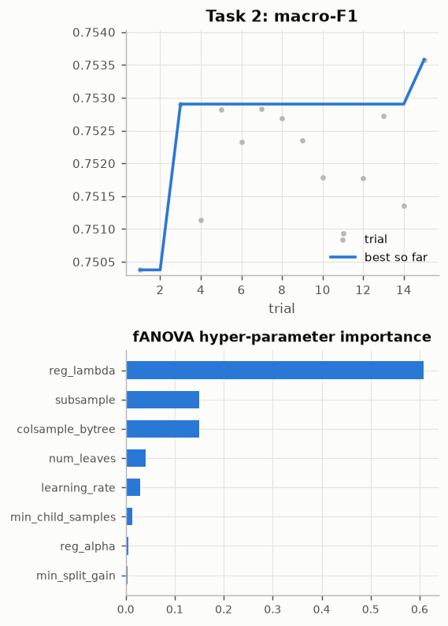  
*รูปที่ 1: วิวัฒนาการคะแนนและการวิเคราะห์ความสำคัญของไฮเปอร์พารามิเตอร์ (fANOVA) จาก Optuna TPE ใน Tasks 1–3 (`outputs/optuna.db`) โดยโมเดลจริงลด Learning Rate ลงครึ่งหนึ่งเพื่อให้ Early Stopping สร้างต้นไม้ที่ละเอียดขึ้นโดยไม่เพิ่มต้นทุนการจูน*

---

### 1.3 การตรวจสอบคุณภาพข้อมูลเชิงระบบ (Automated Data-Quality Audit — `src/audit.py`)
ก่อนเข้าสู่ขั้นตอน Feature Engineering ได้รันชุดตรวจสอบอัตโนมัติบนข้อมูลฝึกสอนของ Tasks 1–3 (และ `test.csv` ของ Task 5) เพื่อตรวจหาความผิดปกติเชิงสถิติและกายภาพ:

| รายการตรวจสอบ | Task 1 (`train`) | Task 2 (`train`) | Task 3 (`train`) | Task 5 (`test` only) | ข้อค้นพบและแนวทางจัดการ |
|---|---|---|---|---|---|
| **จำนวนแถว** | `90,816` | `104,000` | `104,000` | `25,889` | ครบถ้วน ไม่มีแถวซ้ำ (`0` duplicate rows ทุกงาน) |
| **อัตราค่าว่าง (Missing Rate)** | `12.00%` | `8.60%` | `5.80%` | `4.90%` | กระจายแบบ MCAR ทุกคอลัมน์ |
| **Informative Missingness ($p < 0.001$)** | **`0 / 31`** | **`0 / 44`** | **`0 / 32`** | *(ไม่มี Label)* | ค่าว่างไม่สัมพันธ์กับ Target → ใช้ Native NaN ของ GBDT |
| **แถวซ้ำ / คอลัมน์ค่าคงที่** | `0 / 0` | `0 / 0` | `0 / 0` | `0 / 0` | สะอาด ไม่มีคอลัมน์เสื่อม |
| **ความผิดปกติทางกายภาพ / Clipping** | `win_rate` `2.9%` @ `100`, `kill_consistency` `1.1%` @ max | `team_play_percentage` `1.2%` @ `5`, `"NA"` → NaN ใน `region` | `achievement_completion_rate` `4.4%` @ `95` | `207` บัญชีมีพิกัดพ้น $\pm 90° / \pm 180°$; `refund=-1` (`16%`) | พิกัดเกินกรอบมีทั้ง Date-line wrap (~1/3) และ Teleport (~2/3) → ใช้ Wrap-aware Haversine |
| **Collinear Pairs ($\|\rho_s\| > 0.98$)** | ไม่มี | ไม่มี | `historical_spending ~ prev_month_spending` | `login_lat_{1..4}`, `login_lon_{1..4}` | นำโครงสร้าง Collinear/Ratio ไปสร้างฟีเจอร์และซ่อมข้อมูลใน Task 3 & 5 |

---

## 2. Task 1: Anti-Cheat Pre-Filter (Binary Classification — $F_2$)

### 2.1 บริบททางธุรกิจและโจทย์ความไม่สมดุลของต้นทุน (Business Context)
ทีมตรวจสอบของ การีนา ประเทศไทย ได้รับรายงานการโกงมากกว่า **10,000 กรณีต่อวัน** แต่ทีมงานสามารถตรวจสอบด้วยคนได้เพียง **500 กรณีต่อวัน** ทำให้เกิดงานค้างสะสมมากกว่า **45,000 กรณี** ขณะที่ระบบคัดกรองเดิมมี **False Positive Rate สูงถึง 70%** ส่งผลให้ผู้เล่นสุจริตถูกแบนผิดพลาดและสูญเสียความเชื่อมั่นจน Retention ในโหมดแข่งขันลดลง `15%` กระทบรายได้ราว **15 ล้านบาทต่อวัน** (อ้างอิงสไลด์หน้า 14)

เมตริกการแข่งขันคือ **$F_2 = \frac{5PR}{4P+R}$** ซึ่งให้น้ำหนักกับ **Recall มากกว่า Precision ถึง $2^2 = 4$ เท่า** หมายความว่าการปล่อยคนโกงหลุดรอด (*False Negative*) สร้างความเสียหายมากกว่าการส่งผู้เล่นน่าสงสัยให้ทีมงานตรวจสอบเพิ่ม (*False Positive*)

---

### 2.2 การวิเคราะห์ข้อมูลเชิงสำรวจ (EDA) และข้อค้นพบสวนทางสัญชาตญาณ
1. **Label Balance:** จาก `104,000` แถว มีป้ายกำกับ `90,816` แถว เป็นผู้เล่นสุจริต `65.07%` และผู้โกง (`is_cheater = 1`) **`34.93%`** (คัด `13,184` แถวที่ไม่มี Label ออก)
2. **Counter-Intuitive Signal (จุดพลิกผันสำคัญ):** ในชุดข้อมูลนี้ **ทุกฟีเจอร์ที่แยกแยะได้มากที่สุดมีค่า *ต่ำกว่า* ในกลุ่มผู้โกง** เมื่อเทียบกับผู้เล่นสุจริต ได้แก่ `reports_received` ($\rho = -0.3370$, Cohen's $d \approx -0.7$), `crosshair_placement` ($\rho = -0.2280$), `kill_death_ratio` ($\rho = -0.1340$), `headshot_percentage` ($\rho = -0.1330$), `game_sense_score` ($\rho = -0.1250$), `account_age_days` ($\rho = -0.0980$), `accuracy_score` ($\rho = -0.0890$) และ `level` ($\rho = -0.0820$) สาเหตุเกิดจากผู้เล่นเก่งที่เล่นมานานมักถูกผู้แพ้รายงานด้วยอารมณ์โกรธจำนวนมาก สอดคล้องกับปัญหา FP 70% ของระบบเดิมอย่างสมบูรณ์
3. **Class-Specific Support Boundaries:** การกระจายตัวของหลายคอลัมน์มีลักษณะใกล้เคียง Uniform ที่มีขอบเขตต่างกันระหว่างสองคลาส เช่น `reports_received > 19`, `account_age_days > 1,000` และ `crosshair_placement > 0.94` พบ **เฉพาะในผู้เล่นสุจริต 100%** ส่วน `crosshair_placement < 0.82` พบ **เฉพาะในผู้โกง** ทำให้ Decision Trees จับขอบเขตแข็งเหล่านี้ได้ทันที และความยากที่เหลืออยู่กระจุกตัวในบริเวณคาบเกี่ยว (Overlap Region) ที่มี `ROC-AUC ceiling ~ 0.89`

| 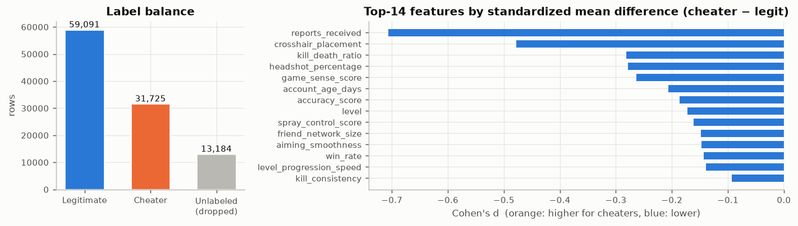 | 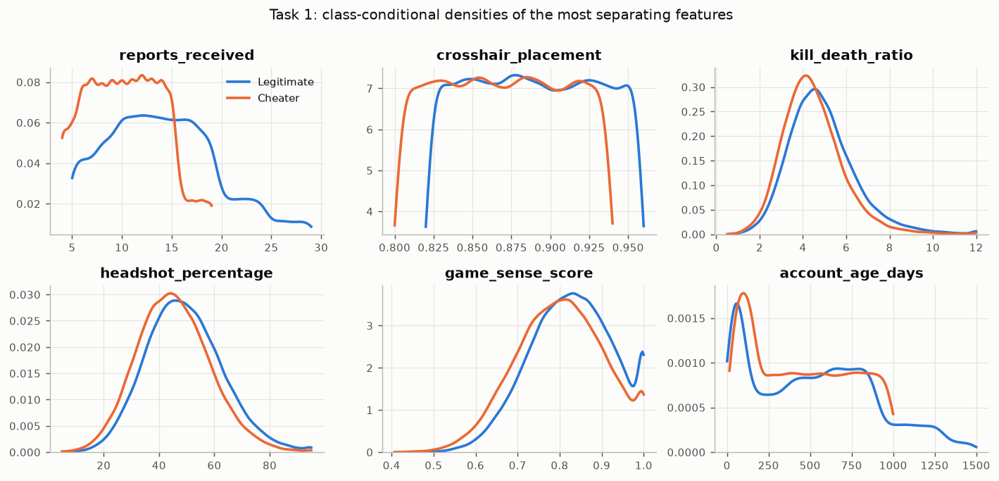 |
|---|---|
| *รูปที่ 2a: สัดส่วนคลาสและ Cohen's $d$ ของ 14 ฟีเจอร์เด่น (สีน้ำเงิน = ต่ำลงในผู้โกง)* | *รูปที่ 2b: ความหนาแน่นเชิงเงื่อนไขแสดง Support Boundaries ของ Top-6 ฟีเจอร์* |

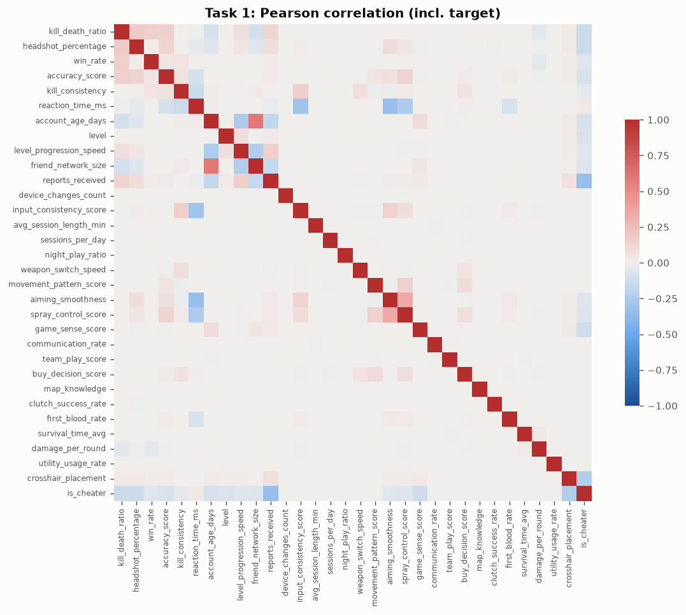  
*รูปที่ 2c: เมทริกซ์สหสัมพันธ์แบบ Pearson ของ Task 1 ชี้ให้เห็นว่าสัญญาณกระจายตัวอ่อนๆ ข้ามหลายคอลัมน์ ไม่มีฟีเจอร์คู่ใดพยากรณ์เดี่ยวๆ ได้สมบูรณ์ (GBDT Territory)*

---

### 2.3 Feature Engineering & ความหลากหลายเชิงสถาปัตยกรรม (`49 Features` + `C24`)
ทีมพัฒนาฟีเจอร์เพิ่มเติม `18` ตัว (`src/task1.py`) บนฐานสมมติฐาน *"Mechanical Skill vs. Human Game Sense"* รวมเป็น `49` ฟีเจอร์ (`X1`):
* **อัตราส่วนความแม่นยำและปฏิกิริยา:** `hs_per_accuracy`, `kd_per_reaction`, `accuracy_per_reaction`, `hs_x_smooth`, `dmg_per_survival`, `kd_x_winrate`, `input_x_smooth`
* **อัตราเทียบอายุบัญชีและระดับ:** `level_per_day`, `reports_per_day`, `reports_per_friend`, `device_changes_per_day`, `kd_per_level`, `daily_playtime`, `skill_per_playtime`
* **ดัชนีเชิงประกอบ (คำนวณ mean/std จาก Train เท่านั้น):** `mech_index` (z-score เฉลี่ยของ 8 ทักษะกลไกและ `-reaction_time_ms`), `sense_index` (z-score เฉลี่ยของ 7 ทักษะการอ่านเกม), และส่วนต่าง `mech_minus_sense` รวมถึง `n_missing`

**บทเรียนจากการทดสอบ Ablation และ `C24` Diversity:**
* บน LightGBM ตัวเดียว: `T1 raw` (`31` cols) ได้ $F_2 = 0.8368$ (`AUC 0.8902`) เทียบกับ `T1 FE` (`49` cols) ได้ $F_2 = 0.8356$ (`AUC 0.8902`) แสดงว่าสัญญาณเป็นแบบ Additive จนต้นไม้จับ Interaction เองได้แล้ว แต่ฟีเจอร์ `mech_minus_sense` และ `reports_per_day` ยังช่วยในการอธิบายโมเดล
* จุดเปลี่ยนที่ดันคะแนนขึ้นจริงคือ **Input Diversity (`C24`)**: การนำโมเดลอีก `4` ตัว (`RF-24`, `LightGBM-24`, `XGBoost-24`, `CatBoost-24`) ที่ใช้คอลัมน์ดิบ `24` ตัว (ตัด `7` คอลัมน์ที่มี Noise/Redundancy สูงออก) พร้อมเติมค่าว่างด้วย Training Median แทน Native NaN (แนวคิดจากทีมแชมป์รุ่นก่อนหน้า แต่เขียนโค้ดใหม่ทั้งหมด) เมื่อนำมารวมใน Stacker เพิ่ม **Nested OOF $F_2$ ถึง `+0.0016`** (`95% CI [+0.0008, +0.0024]`, ดีขึ้น **5/5 Folds**)

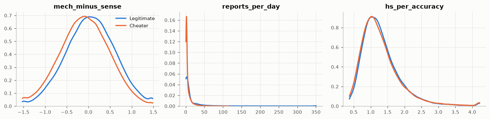  
*รูปที่ 3: การแจกแจงของฟีเจอร์วิศวกรรมหลัก (`mech_minus_sense`, `reports_per_day`, `hs_per_accuracy`) ระหว่างผู้เล่นสุจริตและผู้โกง*

---

### 2.4 สถาปัตยกรรม Ensemble, 10-Seed Bagging และการปรับ Threshold

สถาปัตยกรรมขั้นสุดท้ายของ Task 1 ประกอบด้วย **Level-1 จำนวน 9 โมเดล** โดย `8` โมเดลแบบ Stochastic ทำ **10-Seed Bagging** เฉลี่ยความน่าจะเป็นในสเกล **Log-Odds (`logit`)** ข้าม Seed `(42, 100, 2026, 777, 999, 1234, 5555, 8888, 31415, 27182)` ส่งต่อให้ **Level-2 Multi-Architecture Stacker** (`LogReg + 3-seed LightGBM 8-leaf + 3-seed CatBoost depth-4` เฉลี่ยใน Log-Odds Space: `(logit(LR) + logit(LGB) + logit(Cat)) / 3`) และปรับจุดตัด $\tau$ บน OOF ด้วย Brent Bounded Search (`metrics.optimize_threshold`):

| ระดับ (Stage) | โมเดล (Model) | ชุดฟีเจอร์ / หมายเหตุ | OOF ROC-AUC | Binary-$F_2$ @ Optimum $\tau$ | Optimal $\tau$ | น้ำหนักใน LR Stacker (Log-Odds) |
|---|---|---|---|---|---|---|
| **Level 1** | `LightGBM` (10-seed bag) | `49` features, Optuna `scale_pos_weight=1.0143` | `0.8908` | `0.8359` | `0.1765` | `+0.337` |
| **Level 1** | `XGBoost` (10-seed bag) | `49` features, depth 6, `spw=1.8626` | `0.8883` | `0.8359` | `0.2064` | `-0.056` |
| **Level 1** | `CatBoost` (10-seed bag) | `49` features, oblivious depth 6, `spw=1.8626` | `0.8897` | `0.8361` | `0.2433` | `+0.249` |
| **Level 1** | `ExtraTrees` (10-seed bag) | `49` features, 400 trees, balanced | `0.8538` | `0.8112` | `0.2949` | `-0.325` |
| **Level 1** | `LogReg` (deterministic) | Median impute + QuantileNormal + `C=0.3` | `0.7623` | `0.7575` | `0.2353` | `-0.024` |
| **Level 1** | `RF-24` (10-seed bag) | `C24` + median impute, 300 trees, depth 10 | `0.8392` | `0.8190` | `0.1732` | `+0.136` |
| **Level 1** | `LightGBM-24` (10-seed bag) | `C24` + median impute, lr `0.05`, 31 leaves | `0.8909` | `0.8365` | `0.1706` | `+0.019` |
| **Level 1** | `XGBoost-24` (10-seed bag) | `C24` + median impute, lr `0.05`, depth 6 | `0.8901` | `0.8356` | `0.1732` | `+0.059` |
| **Level 1** | `CatBoost-24` (10-seed bag) | `C24` + median impute, lr `0.08`, depth 6 | **`0.8915`** | **`0.8375`** | `0.1700` | **`+0.671`** |
| **Baseline Blend** | Mean of 9 probabilities | เฉลี่ยเลขคณิตไม่ปรับ Scale | `0.8901` | `0.8349` | `0.2463` | — |
| **Level 2 (LR)** | LogReg Stacker (OOF, `C=1.0`) | Stacked บน 9 OOF Log-Odds (`Round 11`) | `0.8925` | `0.8386` | `0.1581` | — |
| **Level 2 (Final)** | **LR + LightGBM + CatBoost Stacker** | **Log-odds mean ของ Linear + 2 Tree Meta (`Round 26/30`)** | **`0.8929`** | **`0.8388`** | **`0.1631`** | — |

**ผลวิเคราะห์เชิงปริมาณของแต่ละองค์ประกอบ:**
* **Threshold Moving คือหัวใจของ $F_2$:** ที่จุดตัดมาตรฐาน `0.50` คะแนน OOF $F_2$ อยู่เพียง `0.6318` การเลื่อน Threshold มาที่ $\tau = 0.163$ (`τ = 0.162` ใน `v18` ก่อน 10-seed bag) ดันคะแนนขึ้น **`+0.2070` (`0.6318 → 0.8388`)** โดย Flag Rate บนชุดทดสอบอยู่ที่ `60.21%` (เทียบ Base Rate `34.93%`) เพื่อชดเชยน้ำหนัก $4\times$ ของ Recall
* **Breiman One-SE Plateau & ความผิดพลาดจาก Hedging:** ความคลาดเคลื่อนมาตรฐาน (Bootstrap `SE = 0.0013`) สร้างย่านที่ผลลัพธ์เสมอกันทางสถิติอยู่ที่ $\tau \in [0.130, 0.185]$ หากสลับไปตีความเมตริกแบบ Macro-$F_2$ คะแนนที่ $\tau = 0.163$ จะได้ `0.7179` เทียบ `0.7807` ที่ $\tau = 0.405$ (แต่ในสไลด์กำหนดสูตร Positive-Class ชัดเจน และการทดลอง `v4` ที่ขยับ Threshold ไป `0.190` เพื่อเผื่อ Macro กลับทำให้ Public LB ลดลงจาก `0.69663 → 0.69429` จึงถอยกลับและยึด $\tau = 0.163$)
* **10-Seed Bagging & Multi-Arch L2:** การเพิ่ม Tree Meta-Models ให้ Nested Gain `+0.0002` ถึง `+0.0006` (ดีกว่า 4/5 Folds ทั้ง 4 Splits, `v18` Public LB **`+0.00008`**) และการ Bag 10 Seeds เพิ่มอีก `+0.00023` Nested (`v22` Public LB **`+0.00006`**)

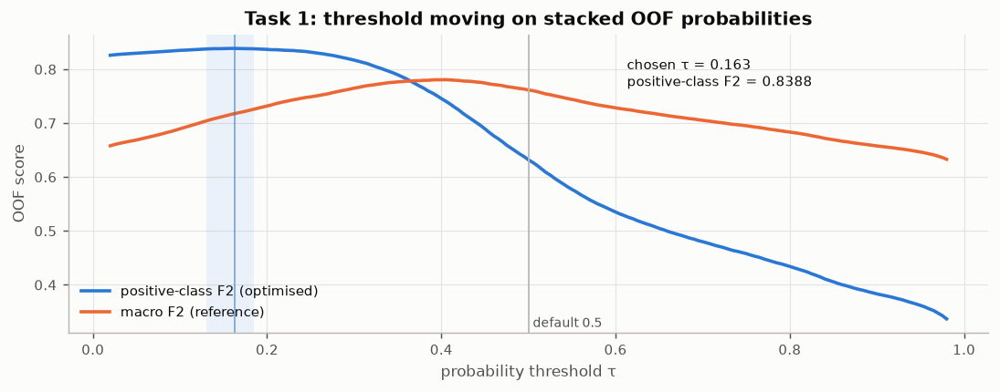  
*รูปที่ 4: เส้นโค้ง OOF Positive-Class $F_2$ เทียบ Macro-$F_2$ แสดง One-SE Plateau `[0.130, 0.185]` และจุดตัดที่เลือก $\tau = 0.163$*

---

### 2.5 Insights, ข้อผิดพลาดที่ควรเลี่ยง และการตีความโมเดลเพื่อธุรกิจ (TreeSHAP)

**ความผิดพลาดที่พบบ่อย (Common Mistakes):**
1. **การเติมค่าว่างและ Missing Indicators บน MCAR:** ทดลองเติมค่าด้วยมัธยฐาน, เพิ่ม Missing Indicators และ Masking-Robust Training ใน Round 10 บน Task 1 แล้วพบว่า **ไม่ผ่านเกณฑ์ Nested CV** (`< 4/5 folds` / CI คร่อมศูนย์) เพราะค่าว่างเป็น MCAR บริสุทธิ์ ขณะที่ `C24` ชนะได้เพราะตัด 7 คอลัมน์ที่ไม่จำเป็นและสร้างความหลากหลายของ Tree Split structure เมื่อใช้คู่กับชุด 49 คอลัมน์
2. **เชื่อ Domain Prior แบบผิดๆ:** หากตั้งกฎหรือ Monotone Constraint ให้ "K/D สูง / รายงานเยอะ = โกง" จะยิ่งซ้ำเติมปัญหา False Positive 70% ของบริษัท

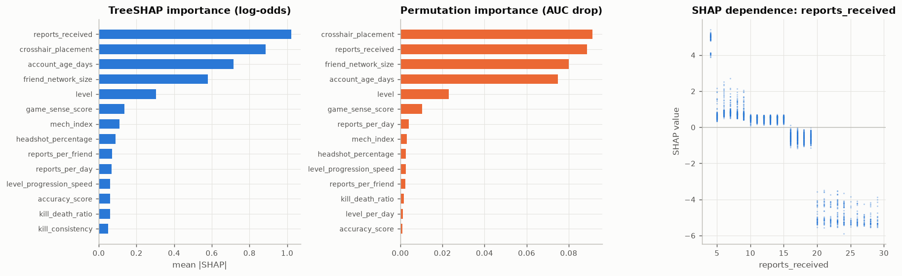  
*รูปที่ 5: TreeSHAP, Permutation Importance (AUC drop) และ SHAP Dependence ของ `reports_received` (ขวา)*

**การตีความสำหรับธุรกิจ (Business Impact):**
* กราฟ SHAP Dependence เผย **ฟังก์ชันขั้นบันได (Step Function)** ของ `reports_received`: **ถูกแจ้ง 4 ครั้งพอดีให้ค่า `+5` log-odds** (มีเฉพาะผู้โกง), **5–15 ครั้ง** ให้แรงผลักบวกอ่อนๆ, แต่ **ตั้งแต่ 20 ครั้งขึ้นไปให้ค่า `-5` log-odds** (เป็นผู้เล่นสุจริต 100%)
* **แผนปฏิบัติการสำหรับ การีนา:** (1) **เปลี่ยนการจัดคิวตรวจสอบจากยอด Report เป็นความน่าจะเป็นจากโมเดล** ส่งต่อคิวสูงสุด 500 ราย/วัน ให้ทีมตรวจสอบจับผู้โกงตัวจริงก่อน, (2) **Auto-Clear ผู้เล่นเก๋าที่ถูกรายงาน 20+ ครั้ง** ที่มี `account_age_days` และ `friend_network_size` สูง ลดภาระและป้องกันการแบนผิดคนจากปัญหา 70% FP, และ (3) แสดง Top SHAP Drivers ให้ผู้ตรวจสอบช่วยลดเวลาตัดสินใจจาก 10 นาทีเหลือระดับยืนยันผลทันที

---

## 3. Task 2: Player Segment Classification (4-Class Classification — Macro-$F_1$)

### 3.1 บริบททางธุรกิจและปัญหาเดิม (Business Context)
การีนา ประเทศไทย ใช้งบการตลาดสูงถึง **60 ล้านบาทต่อเดือน** กับแคมเปญแบบหว่านรวม ส่งผลให้อัตราการมีส่วนร่วม (Engagement Rate) อยู่แค่ **2–5%** เช่น ส่งข่าวทัวร์นาเมนต์ให้สาย Casual หรือส่งโปรลดราคาไอเทมให้คนที่ไม่เคยเติมเงิน ขณะที่ผู้เล่น **Top 5% (Whales) สร้างรายได้ 60% ของบริษัท** แต่การใช้เวลาเล่น (Playtime) เพียงอย่างเดียวไม่สามารถแยก Grinder, Social และ Whale ออกจากกันได้ การแบ่งกลุ่มที่แม่นยำตั้งเป้าเพิ่มประสิทธิภาพแคมเปญ **3–4 เท่า** (สไลด์หน้า 16)

---

### 3.2 EDA, โครงสร้างแฝง `2 × 2` และหลุมพรางของ `"NA"` ใน Pandas
1. **การกระจายตัวของคลาส (`104,000` แถว):** **Casual (`0`) `40,957` (`39.38%`)**, **Grinder (`1`) `26,032` (`25.03%`)**, **Social (`2`) `21,029` (`20.22%`)**, และ **Whale (`3`) `15,982` (`15.37%`)** การที่ Macro-$F_1$ ให้ความสำคัญเท่ากันทุกคลาส ทำให้การทายกลุ่มส่วนน้อย (โดยเฉพาะ Whale `15.4%`) สำคัญเท่า Casual (`39.4%`)
2. **โครงสร้าง `2 × 2` Latent Factor Structure:** การคำนวณ Mean z-score ราย Segment (รูปที่ 6a) เผยโครงสร้างที่สะอาดมาก:

| | การใช้จ่ายต่ำ (**Low Spending**) | การใช้จ่ายสูง (**High Spending**) |
|---|---|---|
| **การเล่นและการมีส่วนร่วมต่ำ (Low Engagement)** | **`0: Casual`** (`39.38%`) | **`2: Social`** (`20.22%`) |
| **การเล่นและการมีส่วนร่วมสูง (High Engagement)** | **`1: Grinder`** (`25.03%`) | **`3: Whale`** (`15.37%`) |

3. **การแยกแยะสัญญาณ vs. Noise:** คอลัมน์อันดับ `loyalty_tier` และ `engagement_level` ให้กำลังจำแนกสูง ส่วน `region`, `platform`, `device_type`, `payment_method`, `language`, `account_status` และ `player_type_tag` มีการแจกแจงเงื่อนไข $P(\text{segment} \mid \text{category})$ แบบแบนราบ (Zero Signal; รูปที่ 6b) และ `random_metric_1..3` เป็น Noise ตาม Data Card
4. **หลุมพรางด้านคุณภาพข้อมูล (`"NA"` Bug):** คอลัมน์ `region` มีค่าว่างถึง `26%` เทียบ `~8%` ในคอลัมน์อื่น เพราะค่าตั้งต้นของ `pandas.read_csv` ตีความรหัสภูมิภาค **"NA" (North America)** เป็น `NaN` ปะปนกับค่าว่างจริง (ไม่กระทบโมเดลเพราะ `region` ไม่มีสัญญาณ แต่ใน Production ต้องใช้ `keep_default_na=False`)

| 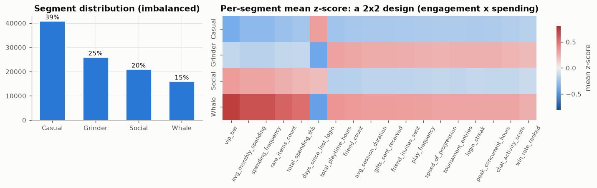 | 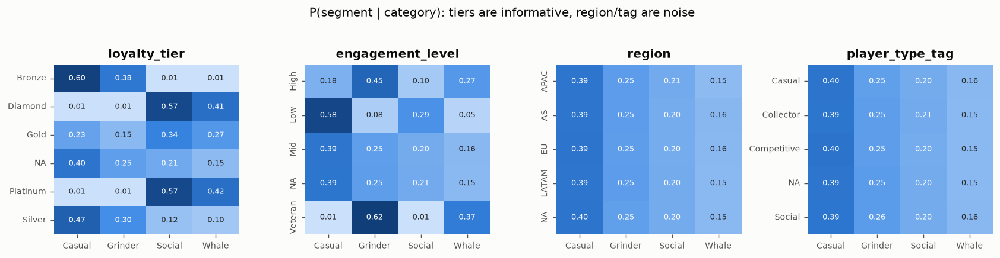 |
|---|---|
| *รูปที่ 6a: สัดส่วนคลาสและ Mean Z-Score ของ 18 ฟีเจอร์หลักสะท้อนโครงสร้าง `2 × 2`* | *รูปที่ 6b: ความน่าจะเป็นมีเงื่อนไขแสดงว่า `loyalty_tier`/`engagement_level` มีสัญญาณชัด ส่วน `region`/`player_type_tag` เป็นสัญญาณรบกวน* |

---

### 3.3 Feature Engineering: ทำไมดัชนีแฝง (Latent Indices) จึงเอาชนะต้นไม้? (`63 Features`)
ทั้ง Engagement และ Spending ถูกวัดผ่านตัวชี้วัดอ่อนที่มีค่าว่างกระจายตัวอยู่ราว `8.6%` ต้นไม้ตัดสินใจไม่สามารถรวมผลเชิงเส้นของตัวชี้วัดอ่อน `8–16` คอลัมน์พร้อมกันได้อย่างมีประสิทธิภาพใน Split เดียว ทีมจึงสร้าง (`src/task2.py`):
* **ตัด Noise และจัดอันดับ Ordinal:** ลบ `random_metric_1..3` และแปลง `engagement_level` (Low→Veteran), `loyalty_tier` และ `skill_tier` (Bronze→Diamond) เป็นตัวเลข
* **NaN-Aware Composite Indices:** หาค่าเฉลี่ย z-score ของกลุ่มตัวชี้วัด (เฉพาะค่าสถิติจาก Train) ข้ามช่อง `NaN` ได้ **`engagement_index`** (จาก 15 ตัวบวก + `-days_since_last_login`), **`spending_index`** (จาก 8 ตัว), พร้อมตัวนับจำนวนค่าไม่ว่าง (`engagement_n_obs`, `spending_n_obs`), Interaction (`eng_x_spend`, `eng_minus_spend`), และอัตราส่วนพฤติกรรม (`spend_per_session`, `spend_per_hour`, `social_engagement`, `monetization_velocity`, `spend_per_txn`, `rare_per_spend`, `chat_per_friend`, `gifts_per_friend`)
* **ผลการทดสอบ (Ablation):** `T2 raw` (`0.7494`) → **`T2 FE` (`0.7549`, พุ่งขึ้น `+0.0055` ทันที!)** และเมื่อเติม **Leakage-free In-Fold Target Encoding (`T2 FE+TE`)** คะแนนคงที่ **`0.7549`** (`0.0000` gain) ยืนยันผล EDA ว่าคอลัมน์ Nominal ไม่มีสัญญาณแฝง จึงใช้ Native Categorical Handling ใน GBDTs แทน

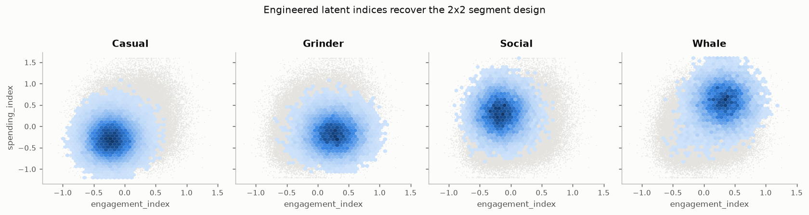  
*รูปที่ 7: การกระจายตัวของทั้ง 4 คลาสบนระนาบ `engagement_index × spending_index` กู้คืนโครงสร้าง `2 × 2` ได้อย่างชัดเจน*

---

### 3.4 สถาปัตยกรรมลูกผสม Discriminative + Generative (`KDE Naive Bayes`) และ Soft Macro-$F_1$

**ข้อค้นพบทางสถิติหลัก (Round 19/23/27):** เมื่อพิจารณาข้อมูลภายในแต่ละ Segment แล้ว ฟีเจอร์ต่างๆ มีความ **เป็นอิสระเชิงเงื่อนไขต่อกันสูง (Class-Conditional Independence)** ทำให้ผลคูณความหนาแน่นแบบ Naive Bayes เข้าใกล้ Bayes-Optimal Classifier และ **สร้างความผิดพลาดคนละจุดกับ GBDT + LogReg**

เราจึงสร้างโมเดล Generative **Kernel Density Estimation Naive Bayes (`task2.kde_nb_predict`)** ที่ฝึกเฉพาะบนแถว Train ใน Fold:
* สำหรับฟีเจอร์ต่อเนื่อง (`cont`): แยกจัดการ **Point Masses ที่ขอบเขต Clipping** (ขอบซ้าย/ขวาที่มีสัดส่วน $\ge 0.2\%$ โดยใช้ Beta-Laplace smoothing `+0.5 / +1`) และประมาณความหนาแน่นภายในด้วย **Gaussian KDE** บนกริด `2,048` จุดด้วย **Silverman Bandwidth** ($h = 0.9 \min(\sigma, \text{IQR}/1.34) n^{-0.2}$) ผ่าน Fast Histogram Convolution และตั้งค่า Floor $10^{-6}\max$ เพื่อป้องกัน log-underflow
* สำหรับคอลัมน์ไม่ต่อเนื่อง ($\le 12$ ค่า): ใช้ Laplace-smoothed frequencies และข้ามเซลล์ `NaN` (MCAR)
* แม้ตัวมันเองจะมีความแม่นยำเพียง `0.7560` (เท่ากับ LogReg Stacker) แต่เมื่อนำมาเฉลี่ยกับ Logistic Stacker (`0.4 Stacker + 0.6 KDE NB`) คะแนนจะขยับแบบก้าวกระโดดเพราะ **ความหลากหลายระหว่าง Discriminative และ Generative** (Nested gain `+0.0012` ถึง `+0.0020` บน 4 Splits, ดีกว่า 4–5/5 Folds, และผลักคะแนน Public LB `v19` ขึ้น `+0.00108`)

**การปรับปรุงกฎตัดสินใจด้วย Soft Macro-$F_1$ Optimization (`Round 34`):**
* **ข้อจำกัดของวิธีเดิม (Powell Search):** Raw Macro-$F_1$ เป็น **ฟังก์ชันขั้นบันได (Step Function)** ที่ไม่ต่อเนื่อง ดังนั้นการจูนน้ำหนักผสม $w_{\text{KDE}}$ และตัวคูณคลาส $w_c$ บน Raw Macro-$F_1$ จะไล่ตาม Noise ข้างขอบตัดสินใจ: ใน Nested CV ของเดิม (`v19–v25`), Powell เลือก $w_{\text{KDE}} \in [0.3, 0.9]$ และ Log-Multipliers แกว่งจาก `-0.05` ถึง `+0.26` ตามแต่ Fold ทำให้ได้ In-Sample สูงเทียม (`0.7584`)
* **นวัตกรรม Soft Macro-$F_1$ (`metrics.optimize_class_weights_soft`):** แทนที่การ Assign แข็งด้วยการ Assign แบบนุ่ม $q_{ic} = \text{softmax}_c\big((\log P_{ic} + v_c)/T\big)$ ที่อุณหภูมิ $T = 0.1$ และหาจุดสูงสุดของฟังก์ชันเรียบ $F_1^{\text{soft}} = \frac{1}{K}\sum_c \frac{2\sum_i y_{ic} q_{ic}}{\sum_i q_{ic} + n_c}$ ด้วย **L-BFGS-B**:
  * ได้ค่าน้ำหนัก $w_{\text{KDE}} = 0.6$ อย่างคงเส้นคงวาใน **27 จาก 30 Folds**
  * บนการทดสอบ Nested เทียบ Powell ทั้ง 4 Splits เดิม (`+0.0005 / +0.0006 / +0.0007 / +0.0003`) และ **6 Splits ใหม่เอี่ยม (`6/6` positive, mean `+0.0006`, Row-Bootstrap 95% CI `[+0.0001, +0.0011]`)**
  * ตัวคูณสุดท้าย: **`Casual: 0.842`, `Grinder: 1.030`, `Social: 1.032`, `Whale: 1.097`** (สัดส่วนทำนายบน Test: `Casual 40.8%, Grinder 25.6%, Social 19.2%, Whale 14.5%`)

| โมเดล / ขั้นตอน | OOF Macro-$F_1$ | หมายเหตุ |
|---|---|---|
| `LogReg` (Numeric only, QuantileNormal, `C=0.5`) | `0.7435` | เส้นฐานเชิงเส้น |
| `CatBoost` (Depth 6, `lr=0.04`, Native Cats) | `0.7545` | Ordered Target Statistics |
| `LightGBM` (Optuna tuned, half LR `0.0294`) | `0.7559` | Leaf-wise |
| `XGBoost` (Depth 5, `colsample=0.5`) | `0.7559` | Depth-wise |
| `Mean of probabilities` (4 L1 Models) | `0.7565` | สูงกว่า Stacker เดี่ยวเล็กน้อย |
| `LogReg Stacker (OOF)` / `+ Powell multipliers` | `0.7560` / `0.7568` | ไม่มี Generative member |
| `KDE Naive Bayes (OOF)` (Generative) | `0.7560` | อิสระเชิงเงื่อนไข, Boundary Point Masses |
| `0.4 Stacker + 0.6 KDE Naive Bayes` | `0.7572` | Nested gain `+0.0012..+0.0020` |
| **`0.4 Stacker + 0.6 KDE NB + Soft-Search Multipliers`** | **`0.7577`** | **ชนะ Powell Nested `+0.0006` (CI > 0, `6/6` splits)** |

---

### 3.5 การวิเคราะห์ความผิดพลาด (Confusion Analysis) และผลกระทบทางธุรกิจ

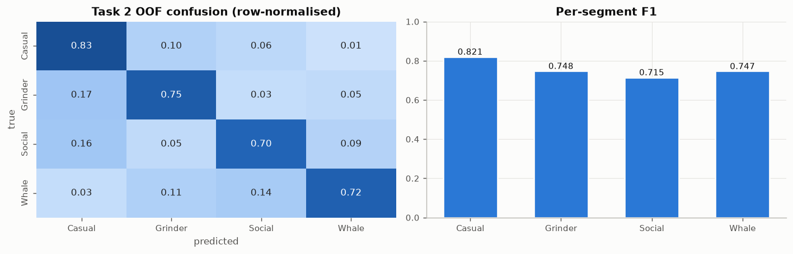  
*รูปที่ 8a: Confusion Matrix และ F1 ราย Segment ของ Task 2 — ความสับสนแทบทั้งหมดเกิดเฉพาะตามแนวแกนเดียว (เช่น Grinder↔Casual หรือ Whale↔Social)*

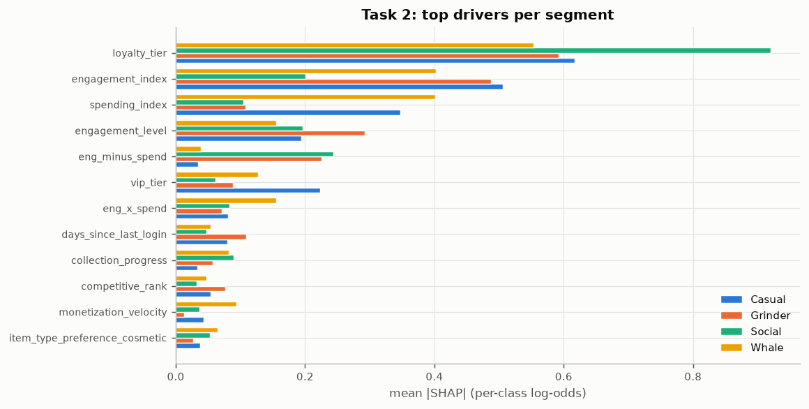  
*รูปที่ 8b: TreeSHAP แสดงให้เห็นว่า `engagement_index`, `spending_index`, `loyalty_tier` และ `engagement_level` ขับเคลื่อนการตัดสินใจเกือบทั้งหมด*

**การเชื่อมโยงสู่ธุรกิจ (฿60M Monthly Budget Allocation):** ด้วยคะแนน `engagement_index` และ `spending_index` เพียงสองแกน ทีมการตลาดของการีนาสามารถจำแนกแผนสื่อสารได้ชัดเจน: (1) **Whales:** บริการ VIP และ Exclusive Bundles **งดส่วนลดหว่าน**, (2) **Socials:** เน้นไอเทม Cosmetic และอีเวนต์สังคม, (3) **Grinders:** เน้นโหมด Ranked และทัวร์นาเมนต์, และ (4) **Casuals:** เน้นโปรโมชันรักษาฐานผู้เล่นเบาๆ แทนการยิงข่าวอีสปอร์ต

---

## 4. Task 3: Player Monthly Spending Prediction (Zero-Inflated Regression — NMAE)

### 4.1 บริบททางธุรกิจ (Business Context)
ทีมการเงินของการีนาพลาดเป้าพยากรณ์รายได้รายไตรมาส **35–40%** ทีมดูแลลูกค้า VIP 20 คนเสียทรัพยากรกับผู้เล่นที่ใช้เวลาเล่นสูง 150 คนที่มียอดเติมรวมเพียง **12,000 บาท** ขณะที่ **Whale ที่เติมเงิน 255,000 บาทต้องรอ Ticket นาน 3 วันจนย้ายไปค่ายคู่แข่ง** นอกจากนี้ การแจกโค้ดส่วนลด `50%` แบบสุ่มยังส่งถึงมือ Whale ที่ยินดีจ่ายเต็มราคาอยู่แล้ว ทำให้ **สูญเสียรายได้กว่า 6 ล้านบาทต่อเดือน** (สไลด์หน้า 18)

---

### 4.2 ทฤษฎีเมตริก (Metric Theory) และ EDA ของข้อมูลยอดเติมเงิน

จาก `104,000` แถว (`32` ฟีเจอร์, MCAR `5.80%`, `0/32` informative):
* **Zero-Inflation & Heavy Right Tail:** **`48.12%` เป็นศูนย์สนิท**, ความเบ้ **Skewness = `4.17`**, มัธยฐาน `79.44` THB, ค่าเฉลี่ย **`10,497.0` THB**, ค่าสูงสุดถูกตัดเพดานที่ **`300,000` THB** (พบพอดี `15` แถว), Quantiles ฝั่งบวก `P10 = 194`, `P50 = 2,314`, `P90 = 74,062`, `P99 = 184,399` THB
* **ความต่างระหว่าง Segment และตัวพยากรณ์หลัก:** `historical_spending` ($\rho = 0.867$) และ `prev_month_spending` ($\rho = 0.865$) มีอิทธิพลสูงมาก รองลงมาคือ `segment` ($\rho = 0.567$): กลุ่ม Casual ไม่เติมเงิน **`72.44%`** (`median 0, mean 74 THB`), Grinder ไม่เติม **`47.96%`** (`med 264, mean 944 THB`), Social ไม่เติม **`30.65%`** (`med 1,838, mean 2,284 THB`), ขณะที่ Whale ไม่เติมเพียง **`7.15%`** (`med 54,760, mean 65,358 THB`)

**การพิสูจน์จุดทำนายที่เหมาะสมที่สุดตามทฤษฎี (Metric-Theoretic Foundation):**  
เมตริกของ Task 3 คือ:
$$\text{NMAE}(y, \hat y) = \frac{1}{1 + \dfrac{\sum_{i=1}^n |y_i - \hat y_i|}{\sum_{i=1}^n y_i}}$$
จะเห็นว่า $\text{NMAE}$ เป็นฟังก์ชันลดทางเดียวของ $\sum |y_i - \hat y_i|$ (Total Absolute Error หรือ $L_1$ Loss) ดังนั้นตัวพยากรณ์ที่ดีที่สุดตาม Bayes Rule คือ **ค่ามัธยฐานแบบมีเงื่อนไข $\text{Median}(Y \mid X)$** **ไม่ใช่** ค่าคาดหวัง $\mathbb{E}[Y \mid X]$ (ซึ่งเหมาะสมเฉพาะกับ MSE/RMSE เท่านั้น) ผลลัพธ์เชิงทฤษฎีนี้ส่งผลโดยตรง `3` ประการ:
1. การแปลง `log1p(y)` ยังคงรักษามัธยฐานไว้ได้เพราะฟังก์ชันเอกโทน (`expm1(Median(log1p Y)) = Median(Y)`) จึง **ไม่ควรคูณ Duan Smearing Factor** สำหรับเมตริกนี้
2. โมเดลที่ฝึกบน `raw THB` (`objective="regression_l1"`) ได้คะแนน **ดีกว่า** โมเดลฝึกบน `log1p` (`0.7867` vs `0.7823`) เพราะ Gradient ใน `log1p` ให้ค่าน้ำหนักแต่ละคนเท่ากัน ส่วนบน `raw THB` ความจุโมเดลไหลไปยังกลุ่ม Whale ที่คุมผลรวม $\sum|y - \hat y|$
3. เมื่อความน่าจะเป็นที่จะเติมเงิน $p = P(Y > 0 \mid X) \le 0.5$ มัธยฐานแบบมีเงื่อนไขของ Zero-Inflated Distribution มีค่าเป็น **`0` สนิท**

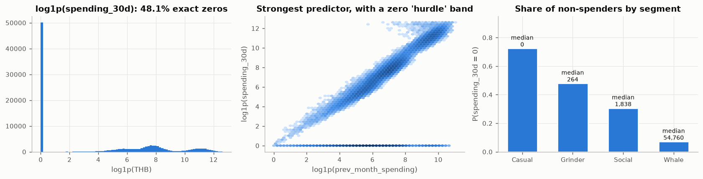  
*รูปที่ 9: การกระจาย `log1p(spending_30d)` (`48.1%` ศูนย์สนิท), ความสัมพันธ์กับ `prev_month_spending` (แสดงให้เห็นว่า "จะเติมไหม" ยากกว่า "เติมเท่าไร"), และอัตราศูนย์ราย Segment*

---

### 4.3 การซ่อมแซมข้อมูลเชิงโครงสร้างแบบ Exact (Target-Free Data Repair) และ RFM Features
แทนที่จะปล่อยค่าว่าง MCAR `5.8%` ทิ้งไว้ให้ต้นไม้เดา ทีมค้นพบโครงสร้างเชิงกำหนด `2` อย่างภายในตัวแปรต้น (ไม่ใช้ Target `spending_30d` และไม่ใช้สถิติข้ามแถวจาก Test):
1. **Exact Within-Row Identities (`task3.fill_identities`):**
   * $\text{historical\_spending} = \text{total\_transactions} \times \text{avg\_transaction\_value}$ (คลาดเคลื่อนสัมพัทธ์เพียง **`2e-16`**)
   * $\text{purchases\_on\_discount} = \text{total\_transactions} \times \text{discount\_rate\_used}$
   * อัตราส่วน $\text{prev\_month\_spending} / \text{historical\_spending}$ อยู่ในช่วง `[0.30, 0.40]` เสมอ (ค่ามัธยฐาน `0.3498` ใช้เฉพาะกรณีขาดทั้งแถว)
   * สามารถซ่อมค่าหายได้ **`5,673 – 5,990` ช่องต่อคอลัมน์ใน Train** (และ **`1,410 – 1,535` ช่องใน Test**) อย่างแม่นยำแทบสมบูรณ์
2. **Rule-Based Segment Imputation (`task3.impute_segment`):** `segment` ที่หาย `5.8%` ถูกกำหนดจากกฎของ `event_participation_rate` และ `historical_spending` จึงฝึก LightGBM Classifier บนแถว Train ที่ทราบ `segment` ทำความแม่นยำ Hold-out **`0.9992`** เติม `5,935` แถวใน Train และ `1,539` แถวใน Test (พร้อม Flag `segment_imputed`)
3. **RFM & Interaction Features (`53` features):** สร้างกลุ่ม `log_hist`, `log_prev`, `monetary_mean_log` ($\rho_s = 0.652$), `prev_x_segment` ($\rho_s = 0.668$), `hist_per_streak`, `txn_value_x_freq`, `recency_ratio` ฯลฯ

---

### 4.4 Ratio-Target Cragg Hurdle, Mixture-Median Read-Out, Exact LP Blend และการทดสอบผล

จากการวิเคราะห์รูปที่ 9b พบว่าสำหรับผู้เติมเงิน ($Y > 0$) ยอดใช้จ่ายเป็นพฤติกรรมเชิงคูณ $Y \approx b \times \text{segment factor} \times \varepsilon$:
* **Ratio Target $\log(1+y) - \log(1+b)$:** ค่า Median Absolute Deviation (MAD) ภายในแต่ละ Segment ของ $\log(y)$ อยู่ถึง `0.44–0.53` แต่เมื่อย้ายไปทำนายส่วนต่างเทียบฐาน `b` (`historical_spending` หรือ `prev_month_spending`) **ค่า MAD ลดฮวบลงเหลือ `0.205`** และ MAE ของ Stage-2 (`log1p` scale) ลดลงจาก **`0.1398` (Plain Hurdle) เหลือ `0.1349` (CatBoost Ratio)** โดยมี Stage-1 Classifier ($P(y>0)$) `AUC = 0.7850`

**สูตรคณิตศาสตร์ของ 3 Read-Outs จาก Cragg Two-Stage Hurdle:**  
เมื่อ Stage 1 ให้ $p = P(Y>0\mid X)$ และ Stage 2 ให้มัธยฐานฝั่งบวก $\mu$ (ในสเกล `log1p`):
1. **Mixture Median (MAE-Optimal ภายใต้ Log-Normal Positive Part):**
$$\hat y_{\text{mix}} = \begin{cases} 0, & p \le 0.5 \\ \exp\!\left(\mu + \sigma\,\Phi^{-1}\!\left(1 - \dfrac{0.5}{p}\right)\right) - 1, & p > 0.5 \end{cases}$$
(โดยจูน $\sigma = 0.156$ และ Gate Shift $-0.000$ บน OOF NMAE — เมื่อ $p \in (0.5, 1)$ ค่า Quantile $1 - 0.5/p$ จะปรับยอดทำนายลงต่ำกว่า $e^\mu - 1$ เพื่อถ่วงโอกาสที่จะเป็น $0$!)
2. **Hard Gate:** $\hat y_{\text{hard}} = \mathbb{I}[p > \tau](e^\mu - 1)$ ($\tau = 0.490$)
3. **Expected Value + Duan Smearing (MSE-Optimal เทียบเปรียบ):** $\hat y_{\text{mean}} = p\,(e^\mu \overline{e^\varepsilon} - 1)$ (`smear = 1.051`)

| กลุ่มโมเดล (Task 3 Member Pool, `repaired features`) | Mixture-Median (NMAE) | Hard Gate (NMAE) | $\mathbb{E}[y]$ + Smearing (NMAE) | Stage-2 `log1p` MAE (Spenders) |
|---|---|---|---|---|
| `LGB-Tweedie` ($p=1.5$, mean estimator) | — | — | `0.77766` (raw mean) | — |
| `Cat-MAE raw THB` | — | — | `0.78435` (direct L1) | — |
| `LGB-L1 log1p` | — | — | `0.78463` (direct med) | — |
| `XGB-L1 raw THB` | — | — | `0.78619` (direct L1) | — |
| `LGB-L1 raw THB` (Optuna tuned) | — | — | `0.78665` (direct L1) | — |
| `Hurdle` (LGB Stage-1 + LGB `log1p` Stage-2, 10-seed) | `0.79112` | `0.78999` | `0.78806` | `0.1398` |
| `ratio[hist] LGB` (default lr `0.05`, 1-seed) | `0.79317` | `0.79204` | `0.79001` | `0.1371` |
| `ratio[prev] LGB` (default lr `0.05`, 1-seed) | `0.79321` | `0.79203` | `0.79008` | `0.1372` |
| `ratio[prev] LGB tuned` (10-seed, LP wt **`0.125`**) | `0.79388` | `0.79268` | `0.79074` | `0.1359` |
| `ratio[hist] LGB tuned` (10-seed) | `0.79393` | `0.79272` | `0.79075` | `0.1358` |
| `ratio[hist] XGB` (10-seed, LP wt **`0.200`**) | `0.79403` | `0.79286` | `0.79082` | `0.1356` |
| **`ratio[hist] Cat`** (10-seed, LP wt **`0.675`**) | **`0.79447`** | `0.79329` | `0.79123` | **`0.1349`** |
| **OOF Exact LP $L_1$ Blend (HiGHS)** + Zero Gate + Scale `1.000` | **`0.79446`** | — | — | *(แก้สมการ LP เชิงเส้นตรง)* |
| **+ Training-Maximum Cap (`300,000` THB)** | **`0.79458`** | — | — | *Final OOF (`4/5 folds`, v12 LB `+0.00006`)* |

**รายละเอียดทางคณิตศาสตร์ที่ผลักคะแนนจริง:**
* **Mixture Median ชนะทุก Read-Out อย่างสม่ำเสมอ:** ในทุกโมเดล Mixture-Median ชนะ Hard Gate ราว `+0.0012` และชนะ $\mathbb{E}[y]$ + Smearing ถึง **`+0.0032` NMAE**
* **10-Seed Bagging ใน THB Space (`Round 14/26/27`):** นำ $\mu$ ของแต่ละ Seed มาแปลงผ่าน `apply_readout` เป็นบาทก่อนแล้วค่อยหา Arithmetic Mean (สอดคล้องกับการ Blend และคะแนน NMAE ในบาท, ชนะ Log-scale Geometric Mean `4/5 folds`) เพิ่ม Nested NMAE **`+0.00024`** (`95% CI [+0.00011, +0.00037]`, **5/5 Folds**)
* **Exact Linear Programming $L_1$ Blend (`task3.l1_blend_weights_exact`):** แก้ $\min \sum (u_i + v_i)$ ภายใต้ $Pw + u - v = y,\ w, u, v \ge 0$ ด้วยตัวแก้ HiGHS ได้คำตอบ Global Optimum แบบ Deterministic ชนะ Powell Search **`+0.00007` NMAE** (`95% CI [+0.00001, +0.00014]`)
* **Training-Max Cap (`300,000` THB):** เนื่องจาก Target ถูก Truncate ที่ 300k การตัดเพดานที่ `max(train)` ช่วยป้องกัน Overshoot ของผู้เติมรายใหญ่ (`+0.00011` OOF NMAE, `4/5 folds`, และยืนยันจริงบน Public LB `v12` ที่เพิ่มขึ้น `+0.00006` จากแถว `ANS14698: 431,946 -> 300,000`)

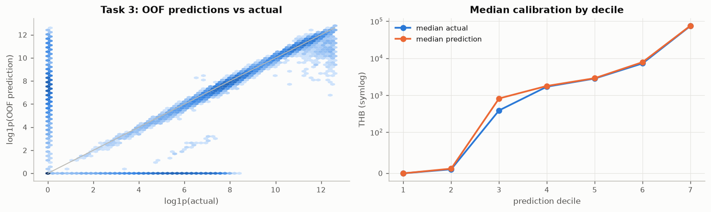  
*รูปที่ 10: Hexbin ค่าพยากรณ์ OOF เทียบยอดจริง (ซ้าย) และ Median Calibration ราย Decile (ขวา) แสดงความสอดคล้องแม่นยำตลอดทุกช่วงตั้งแต่ 0 ถึงระดับแสนบาท*

---

### 4.5 การตีความโมเดล (TreeSHAP) และผลกระทบทางธุรกิจ

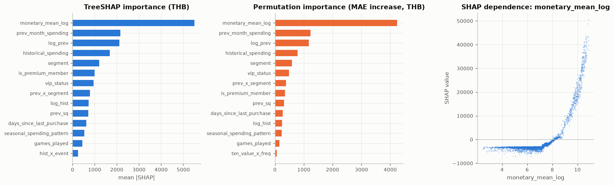  
*รูปที่ 11: TreeSHAP, Permutation Importance (MAE increase ในหน่วย THB) และ SHAP Dependence ของ `monetary_mean_log`*

กราฟ SHAP Dependence ของ `monetary_mean_log` มีลักษณะ **แบนราบที่ค่าลบต่ำกว่า ~`7` ($\approx 1,100$ THB) แล้วชันขึ้นทันทีเหนือจุดนั้น** ยืนยันว่าเฉพาะผู้เล่นที่มียอดเติมสะสมชัดเจนเท่านั้นที่จะสร้างเม็ดเงินก้อนใหญ่ในเดือนถัดไป การีนาสามารถนำโมเดลไป:
1. **จัดเส้นทาง VIP Desk ด้วยยอดพยากรณ์:** ป้องกันความผิดพลาดที่ดูแลผู้เล่น Free-to-Play นาน 150 คนแต่ปล่อยให้ Whale 255k THB รอคิวนาน 3 วัน
2. **ระงับคูปอง 50% ที่ไม่จำเป็น:** หยุดแจกส่วนลดให้บัญชีที่พยากรณ์ว่าจ่ายสูงโดยธรรมชาติ ยุติการรั่วไหล **6 ล้านบาท+/เดือน** แล้วรวมส่วนลดไปกระตุ้นผู้เล่นแถบ Low/Zero ที่มี Activity ล่าสุด
3. **พยากรณ์รายได้การเงินสองมุม:** ใช้ผลรวม Conditional Median เป็นการพยากรณ์แบบอนุรักษนิยม (Conservative, Outlier-Robust) คู่กับ `LGB-Tweedie` สำหรับค่าคาดหวัง (Expected Total)

---

## 5. Task 5: Account Security Monitoring (Unsupervised Anomaly Detection — $F_3$)

### 5.1 บริบททางธุรกิจ (Business Context)
การีนาเผชิญเหตุ **การโจรกรรมบัญชีมากกว่า 5,000 บัญชีต่อเดือน** (ยอดจริงสูงกว่านี้อีก ~2 เท่า) คิดเป็น **60% ของภาระงาน Customer Support** นอกจากการแฮ็กยังมีฟาร์มบอต 24/7, ตลาดซื้อขาย/ปั้นไอดี, และการมุด VPN เอาส่วนลดภูมิภาค `70%` ขณะที่ระบบกฎตายตัวเดิมมี **False Positive สูง 60%** (แบนนักเดินทางสุจริต แต่พลาดคนร้ายที่รอ 24 ชม. ก่อนลงมือ) งานนี้ **ไม่มี Training Labels ให้เลย มีเพียง `test.csv` จำนวน `25,889` บัญชี × 4 ช่วงเวลา (`122` คอลัมน์, `4.84%` missing)** ภายใต้เมตริก **$F_3 = \frac{10PR}{9P+R}$** ที่ลงโทษการพลาด Threat (*False Negative*) **หนักกว่า False Alarm ถึง $3^2 = 9$ เท่า**

---

### 5.2 EDA และข้อค้นพบสองระบอบ (Temporal Jump vs. Persistent Abnormalities)
1. **Period-4 Temporal Shift:** เมื่อเทียบความเบี่ยงเบนของช่วงเวลาที่ `4` กับ Baseline ช่วง `1–3` ของบัญชีตัวเอง (`dev4`) เทียบกลุ่มควบคุม (ช่วง `1` เทียบ `2–3`) เส้นกราฟซ้อนทับกันจนถึง Percentile ที่ `~98` ก่อนจะระเบิดขึ้นสูงชันในบางกลุ่มพฤติกรรม (รูปที่ 12a):
   * **Takeover / VPN Abuse:** `location_changes`, `currency_transfers`, `purchase_*` พุ่งพร้อมระยะกระโดดล็อกอิน
   * **Skill Boost + Friend Purge:** `skill_rating`, `skill_trajectory`, `kda_mean`, `accuracy_mean` พุ่งพร้อมการลบเพื่อน (`friend_removes`) และ `reaction_time` ลดลง
2. **ข้อผิดพลาดของกฎพิกัดพ้นโลก (`±90°/±180°`):** พบ `207` บัญชีที่มีพิกัดเกินขอบโลก (รูปที่ 12b) ทว่าประมาณ **1 ใน 3 เป็นผู้เล่นปกติใกล้เส้นแบ่งวัน (Date Line Wrap)** ที่พิกัดข้าม $\pm 180°$ โดยไม่ได้เดินทางจริง มีเพียง `2/3` ที่เป็นบัญชี Teleport ดังนั้นจึงสร้าง Haversine Geodesic Distance ที่รองรับการวนรอบโลก (`179` ฟีเจอร์ใน `task5.build_features`: 9 Geodesic, 27 `dev4`, 27 `selfz4`, 81 Dynamics `maxjump/burst/cv`, 27 all-period `level`, static และ 4 flags)
3. **ความผิดปกติแบบคงที่ตลอดกาล (Persistent Regimes):** บัญชีบอตไอพีเดียว (`ip_hash_entropy`), บัญชีเงียบสนิท (`communication_frequency`), บัญชีนิ่งเกือบตาย (`activity_level`) และบัญชีเสถียรภาพต่ำ (`behavior_stability`) ผิดปกติเหมือนกันหมดทั้ง 4 ช่วงเวลา ทำให้ **`dev4 ≈ 0` (มองไม่เห็นเลยหากดูเฉพาะการเปลี่ยนแปลง)** จึงจำเป็นต้องสร้างฟีเจอร์ค่าเฉลี่ยทุกช่วง (`_level`)

| 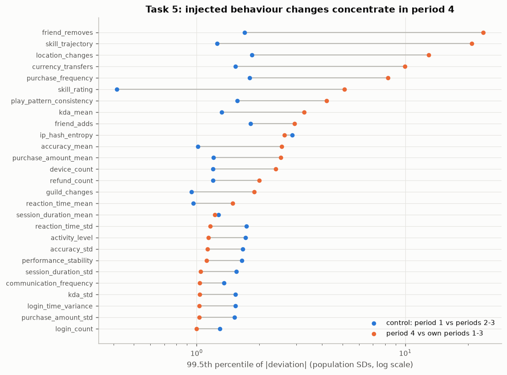 | 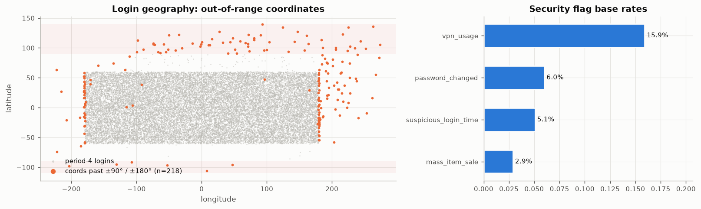 |
|---|---|
| *รูปที่ 12a: Percentile ที่ 99.5 ของช่วงที่ 4 เทียบช่วงควบคุม แสดงพฤติกรรม Takeover & Boost ที่ถูกฉีดเข้ามา* | *รูปที่ 12b: พิกัดเกิน $\pm 90°/\pm 180°$ (`207` บัญชี) และอัตรา Flag พื้นฐาน* |

---

### 5.3 สถาปัตยกรรม 3 เสาหลักแบบปลอด Label (Three-Pillar Label-Free Architecture)

#### เสาหลักที่ 1: ตัวตรวจจับช่องว่างความหนาแน่น 1 มิติ (`gap_clusters` — Zero Hand-Set Thresholds)
จากการสังเกตใน EDA เช่น `behavior_stability` ของคนทั่วไปกระจายสม่ำเสมอในช่วง `[0.70, 0.95]` ส่วน `247` บัญชีอยู่ช่วง `[0.20, 0.40]` โดยมี **ช่องว่างสนิท (Empty Gap)** คั่นกลาง แสดงว่าเป็นประชากรคนละกลุ่ม ไม่ใช่แค่ปลายหางปกติ (`Long Tail`)

ในฟังก์ชัน `task5.gap_clusters`: สำหรับแต่ละคอลัมน์ต่อเนื่องภายในปลาย `10%` ซ้ายและขวา ถ้าช่องว่างกว้าง $w$ อยู่ติดประชากรหนาแน่น $d$ (จาก `200` บัญชีใกล้ขอบช่องว่าง) จำนวนบัญชีที่ **ควรจะตกในช่องว่างตามการแจกแจงต่อเนื่องคือ $\lambda = d \cdot w$** และโอกาสที่จะว่างเปล่าโดยบังเอิญภายใต้ Poisson Process คือ $P(\text{gap empty}) \approx e^{-\lambda}$:
* ยอมรับเป็น **Isolated Tail Cluster** เมื่อ $\lambda \ge 50$ (`min_size = 20`, `max_share = 0.03`) แล้วรวมกลุ่มที่ซ้อนทับ $\ge 50\%$ ด้วย **Union-Find (`merge_families`)**
* **ผลลัพธ์:** พบ **`33` Isolated Clusters** หลอมรวมเป็น **`6` ครอบครัวประชากรแยกตัว (`1,809` บัญชี = `6.99%`)** โดยค่า Cutoff ถูกกำหนดจากข้อมูลเองและ **ให้ผลลัพธ์เป็นกลุ่ม `1,809` บัญชีนี้คงเดิมเป๊ะ** ทั้งที่ $\lambda \ge 50, 100, 300$, ย่าน `100–400`, หรือ `min_size 10–50`:

| ครอบครัวความผิดปกติ (Anomaly Family) | จำนวนบัญชี (Share) | คอลัมน์ที่แยกได้ | ตัวอย่างช่องว่างหลัก ($\lambda$ = Expected in Gap) | สัดส่วนที่ Score Ensemble จับได้ |
|---|---|---|---|---|
| **1. Takeover / VPN Abuse** | **`517`** (`2.00%`) | `7` | `location_changes_4 > 4.317` ($\lambda = 1,138$), `currency_transfers_4 > 15.99` ($\lambda = 1,982$), `purchase_frequency_4 > 8.022` ($\lambda = 2,073$), `geo_hop_max > 814.4` ($\lambda = 398$) | **`100.0%`** |
| **2. Skill Boost + Friend Purge** | **`310`** (`1.20%`) | `2` | `friend_removes_4 > 12.45` ($\lambda = 42,064$), `skill_trajectory_4 > 36.25` ($\lambda = 541$) | **`100.0%`** |
| **3. Near-Inactive (ปั้นไอดีเงียบ)** | **`265`** (`1.02%`) | `4` | `activity_level_{1..4} < 0.326..0.364` ($\lambda = 175..596$) | **`8.3%`** *(พลาดเกือบหมด!)* |
| **4. Silent (ไร้การแชทตลอดกาล)** | **`263`** (`1.02%`) | `4` | `communication_frequency_{1..4} < 0.156..0.178` ($\lambda = 537..923$) | **`8.7%`** *(พลาดเกือบหมด!)* |
| **5. Erratic (Low Stability)** | **`247`** (`0.95%`) | `2` | `behavior_stability < 0.5499` (`gap 0.400–0.700`, $\lambda = 29,912$) | **`78.9%`** |
| **6. Single-IP Bots** | **`207`** (`0.80%`) | `14` | `ip_hash_entropy_{1..4} < 0.250` ($\lambda = 4,227..5,431$), `login_time_variance`, `session_duration_std` | **`51.2%`** |
| **รวม 6 Families** | **`1,809`** (`6.99%`) | **`33` clusters** | **Derived-Feature Completeness Scan (`dev4`/`jump`/`level`): พบ `39` กลุ่ม (`1,562` บัญชี) — `0` บัญชีอยู่นอก 6 ครอบครัวนี้** | `ROC-AUC = 0.9033` |

#### เสาหลักที่ 2: การสอบทานข้ามด้วย 7 ตัวตรวจจับสถิติและหลักฐานปฏิเสธ Ensemble Tail
ทีมรันตัวตรวจจับ `7` ชนิด (`ExtremeValue`, `IsolationForest`, `ECOD`, `COPOD`, `LOF`, `Mahalanobis(MCD)`, `CPU MLP AutoEncoder` ด้วย Huber Loss) ปรับสเกลด้วย Median/MAD (`robust_z`) คัด `LOF` ออก (ความครอบคลุม $\le 0.29$, วัดความหนาแน่นใน 70+ มิติแล้วไวต่อ Noise) ได้ Ensemble 6 โมเดลที่มี `ROC-AUC = 0.9033` เทียบ Gap Families (Kneedle Knee ที่ Top **`8.05%`**):
* **ทำไม Score Ensemble แบบมาตรฐานจึงไม่พอ?** แม้ตัวตรวจจับสถิติจะจับกลุ่ม Spike ได้ `100%` แต่ **มองไม่เห็นกลุ่ม Near-Inactive (`8.3%`) และ Silent (`8.7%`) เลย** เพราะระยะห่างเชิงสถิติอยู่เพียง ~2 robust SD จึงถูกกลบด้วย Noise ใน 70+ มิติ
* **ทำไมจึง *ไม่* รวม `913` บัญชีส่วนเกินจาก Ensemble Knee เข้าคำตอบ?**
  1. ค่า Median ของ `max |robust z|` ใน `913` บัญชีนี้อยู่แค่ **`1.49`** (เทียบ `2.90` ใน 6 Families และ `1.01` ในคนปกติ)
  2. **Poisson-Binomial Null Test:** เมื่อตรวจจำนวน Security Flags (`0, 1, 2, 3, 4`) ในบัญชีนอก 6 Families พบจำนวนจริง **`14,711 / 4,534 / 378 / 15 / 0`** ซึ่งตรงกับสมมติฐานที่ว่า Flags ทั้ง `4` เกิดอย่าง **อิสระต่อกัน (`14,734.6 / 4,485.9 / 403.4 / 13.9 / 0.2`)** หมายความว่า `913` บัญชีนั้นคือ **ขอบรบกวนของบัญชีปกติ (Noisy Edge of Normal Behavior)** ที่ถูกดึงขึ้นมาเพียงเพราะเป็น input ของโมเดล การทดลอง `v4` ที่เอา Union เข้าส่งยืนยันชัดเจนว่าคะแนน Public LB ตกลง (`0.69663 → 0.69429`)

| 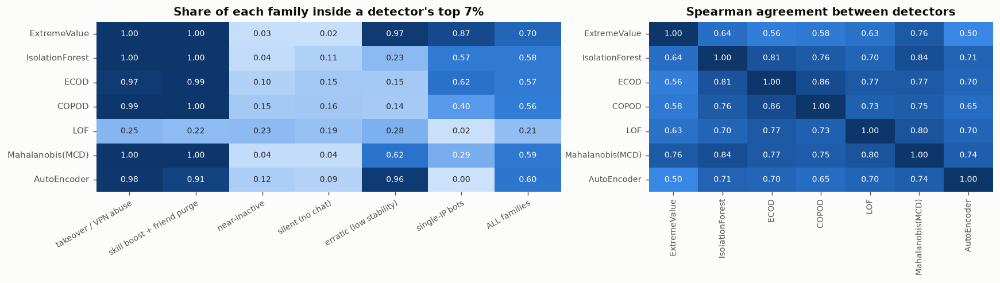 | 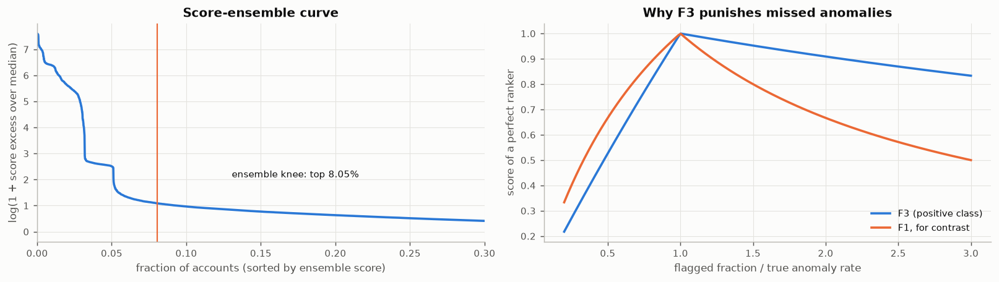 |
|---|---|
| *รูปที่ 13a: สัดส่วนการดักจับแต่ละ Family ที่ Top 7% — พิสูจน์ว่าตัวตรวจจับสถิติพลาดกลุ่ม `near-inactive` และ `silent`* | *รูปที่ 13b: Kneedle Score Curve (`8.05%`) และเส้นโค้ง $F_3$ ที่ลงโทษ False Negative สูงถึง 9 เท่า* |

#### เสาหลักที่ 3: Blind 2-D Dependence Pocket Discovery & Cross-Fitted Period-Profile Density Ratio (`Round 31–32`)
สมมติฐานสำคัญข้อถัดมาคือ: *"มีพฤติกรรมผิดปกติแบบซ่อนตัวที่ **ไม่ทิ้งช่องว่าง 1 มิติ** เลยหรือไม่?"* ทีมจึงสแกนคู่ฟีเจอร์ทั้งหมด **`11,319` คู่** บนตาราง `20 × 20 Quantile Grid` ในกลุ่มบัญชีนอก 6 Families เทียบ Noise Floor จาก Column-Shuffled Null (`max shuffled z = 10.9`):
1. **ค้นพบ Pocket เดียวในทั้งชุดข้อมูล (`task5.dependence_pockets`):** **`accuracy_std_level × kda_std_level`** ที่มุมบนขวา `(bin 19, 19)` มีค่า **$z = 21.0$ (`223` บัญชีจริง เทียบค่าคาดหวัง `60.3`)** คู่รองลงมาทั้งหมดอยู่แค่ $z \le 8.7$ (ต่ำกว่า Noise Floor) — สะท้อน **บัญชีแชร์/ปั๊มแรงก์ (Erratic Performance)** ที่มีค่า KDA และความแม่นยำแกว่งตัวสูงผิดปกติพร้อมกัน
2. **Bonferroni 3rd-Column Scan (`task5.pocket_extra_column`):** ทดสอบ Residual Shift ของคอลัมน์ `_level` อีก `20` คอลัมน์เทียบค่าทำนายเชิงเส้นจากสองคอลัมน์แรก (Bonferroni Bound ที่ $\alpha=0.001$ คือ `|z| = 4.06`) พบ **คอลัมน์ที่ 3 เพียงตัวเดียวที่ผ่าน:** **`performance_stability_level` ($z = 16.394$, mean rank `0.751` vs predicted `0.495`)** ขณะที่อีก 19 คอลัมน์มี `|z| <= 1.591`
3. **Neyman-Pearson Density Ratio & Block-Shuffle Profile Refinement (`task5.pocket_refine`):** เพื่อดักขอบเขตทรงมุมที่แม่นยำกว่า Square Corner (`min-rank`) และตัดความผิดพลาดโดยไม่แตะ Label ทีมนิยาม Null ระดับ Profile (`3` พฤติกรรม × `4` ช่วงเวลา = `12` มิติ + Across-behaviour summaries) ด้วยการสับสลับ **ระดับ Behavior Block ทั้งก้อน (`Block-Shuffle Null`)** ที่รักษาความสัมพันธ์ภายในพฤติกรรมเดียวกันข้าม 4 ช่วงเวลา แต่ทำลายความเชื่อมโยงข้าม 3 พฤติกรรม แล้วให้ `HistGradientBoostingClassifier` (`300` trees, `8` leaves, `min_samples_leaf=200`) แบบ **40-split Cross-Fitting** ประมาณ Log-Odds Density Ratio เลือกจุดตัด $k^*$ ที่เพิ่ม Expected $F_3$ สูงสุดเทียบ `200` Block-Shuffle Draws:
$$\mathbb{E}[F_3(k)] = \frac{10\,(n_{\text{known}} + \widehat{\text{TP}}(k))}{9\,(n_{\text{known}} + \hat G) + n_{\text{known}} + k}, \quad \widehat{\text{TP}}(k) = k - \mathbb{E}_{\text{null}}[\text{count}_{\ge s_{(k)}}]$$

| วิธีประมาณขอบเขต Dependence Pocket | คอลัมน์ / ข้อมูลที่ใช้ | Estimated Group Size $\hat G$ | จุดตัด $k^*$ | Estimated TP | Estimated Precision | Expected $F_3$ (Common $\hat G$) | ผลกระทบเมื่อส่ง Kaggle |
|---|---|---|---|---|---|---|---|
| *Families Only (`1,809`)* | — | — | `0` | — | — | `0.896` | พลาดกลุ่ม Erratic Performance |
| **1. `min-rank` (2-D Square Corner)** | `accuracy_std_level × kda_std_level` | `201.07` | `339` | `194.46` | `0.574` | `0.976` | (`v14`: แจ้งเตือนเยอะ Precision ต่ำ) |
| **2. Cross-Fitted 3-D Copula Density Ratio** | `200` halvings, `1,000` col-shuffles ($h=0.40$) | `224.10` | `265` | `224.10` | `0.846` | `0.994` | `v24`: Public LB **`+0.00174`** (`~+0.009 F3`) |
| **3. Cross-Fitted 12-D Period-Profile Ratio** | **ทั้ง 4 periods ของ 3 พฤติกรรม (`block-shuffle null`)** | **`233.98`** | **`244`** | **`233.57`** | **`0.957`** | **`0.999`** | `v25`: Public LB **`+0.00013`** (`~+0.0007 F3`) |

* **ข้อสรุป Task 5 ขั้นสุดท้าย:** รวม **6 Gap-Separated Families (`1,809`) + 1 Period-Profile Dependence Pocket (`244`, คงเดิมจาก min-rank 227 และเพิ่มเติมแม่นยำ 17) = `2,053` บัญชี (`7.93%`)**

---

### 5.4 Alert Explainability และ Playbook สำหรับทีมความปลอดภัย

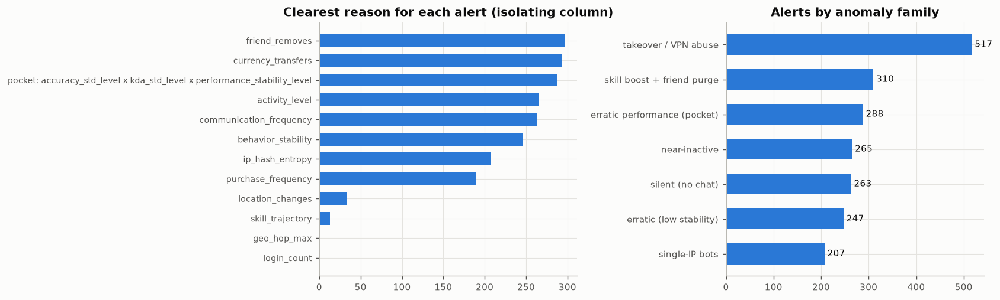  
*รูปที่ 14: สาเหตุเฉพาะรายบัญชี (คอลัมน์ที่แยกกลุ่มขาดชัดที่สุด) และจำนวนการแจ้งเตือนแยกตามตระกูลความผิดปกติ*

แทนที่จะได้ Flag แบบคลุมเครือและ FP 60% ทีมความปลอดภัยของ การีนา จะได้รับการแจ้งเตือนพร้อมประเภทและ Playbook ดำเนินการอัตโนมัติ:
* **Takeover / VPN Abuse (`517`):** แช่แข็งการโอนไอเทม/เงินทันที บังคับรีเซ็ตรหัสผ่าน + MFA และปรับราคาตามภูมิภาคจริง
* **Skill Boost + Friend Purge (`310`) & Erratic Performance Pocket (`244`):** ส่งตรวจบัญชีแชร์/ขายไอดี พร้อมแจ้งเตือนเจ้าของบัญชีจริง
* **Single-IP Bots (`207`):** จำกัด Rate-limit และ Batch-ban ยกกลุ่มตาม IP/พฤติกรรม Clockwork
* **Near-Inactive (`265`) & Silent (`263`):** ติดตามพฤติกรรม Farm / บัญชีม้า เฝ้าระวังการโอนทรัพย์สินเข้า

---

## 6. Task 4: Game Title Detection `[Reserved — รอผนวกผลขั้นสุดท้าย]`

> **หมายเหตุ (Placeholder Section):** ตามคำขอสำหรับเอกสารชุดนี้ ได้กันพื้นที่ส่วนที่ `6` ไว้รองรับ Task 4 (*Game Title Detection — 5-class Image Classification, Macro-$F_1$*) เมื่อการทดลองด้าน Vision รอบสุดท้ายเสร็จสมบูรณ์ โดยมีโครงสร้างหัวข้อย่อยเตรียมพร้อมดังนี้:
> * **6.1 Business Context & Dataset Audit** (`2,000` daily screenshot tickets, `50,000+` campaign fraud checks, `31,546` train RGB images `230×120` ไร้ duplicate)
> * **6.2 Exploratory Data Analysis & Shift Diagnostics** (Corruptions: Rotation/Inversion/Hue-shift/Dark/Low-contrast; Class imbalance `39.4%` 7-Eleven Knights vs `10.1%` Roblock)
> * **6.3 Aspect-Preserving GPU Augmentation, Fine-Tuned CNN/ViT Progression & Brightness/Contrast Gate**
> * **6.4 Frozen Foundation Probes, Multi-Resolution Inference & Nested 5-Fold Selection**
> * **6.5 Grad-CAM Explainability, Business Impact & Operational Confidence Gate**

---

## 7. การทำงานร่วมกันของทีม มาตรฐานวิศวกรรม และ Reproducibility (Team Collaboration & Engineering Workflow)

### 7.1 บทบาทหน้าที่และหลักการทำงานร่วมกันของทีม `ML007` (Team Collaboration & Takeaways)
การแข่งขันรอบนี้ครอบคลุมทั้งข้อมูลตาราง 3 แบบ (Binary, Multi-Class, Zero-Inflated Regression), Computer Vision และ Unsupervised Time-Window Anomaly Detection ภายใต้เวลาจำกัด ทีมจึงแบ่งงานคู่ขนานพร้อมกติกา **Single-Source Pipeline Governance**:

| สมาชิกทีม (รหัสนักศึกษา / ชื่อ)* | บทบาทและความรับผิดชอบหลัก (Primary Ownership) | สิ่งที่ได้เรียนรู้สำคัญ (Key Takeaways) |
|---|---|---|
| **Member 1** *(ระบุชื่อ-สกุล / รหัส)* | **System Architect, Validation Protocol & Data Audit:** ออกแบบ 5-Fold ร่วม (`src/modeling.py`), `src/audit.py`, ระบบสร้าง Notebook (`nb_part1/2.py`), Snapshot/Rollback | การล็อก Split กลางและบังคับ Nested CV ตั้งแต่ต้นช่วยป้องกันการหลอกตัวเองจากการปรับจูน Threshold หรือ Multiplier ซ้ำซ้อน |
| **Member 2** *(ระบุชื่อ-สกุล / รหัส)* | **Task 1 (Anti-Cheat) Lead:** วิจัยความสัมพันธ์ย้อนกลับของ `reports_received`, `C24` Diversity, 10-Seed Bagging, Multi-Arch L2 Stacker และ One-SE Threshold Moving | ความหลากหลายจาก Feature Set/Imputation ที่ต่างกัน (`C24`) และ Metric-aware Thresholding ให้ผลต่างสูงกว่าการไล่จูน Hyperparameter เพียงอย่างเดียว |
| **Member 3** *(ระบุชื่อ-สกุล / รหัส)* | **Task 2 (Segmentation) Lead:** วิศวกรรม Latent `2×2` Index, ตรวจจับ Bug `"NA"` ใน Pandas, สถาปัตยกรรม `KDE Naive Bayes` และ `Soft Macro-F1` Optimization | การรวม Generative Model กับ GBDT เมื่อข้อมูลมีโครงสร้างกึ่งอิสระ และการใช้ฟังก์ชันเรียบช่วยขจัด Step-Function Overfitting |
| **Member 4** *(ระบุชื่อ-สกุล / รหัส)* | **Task 3 (Spending) Lead:** Data Repair ด้วยเอกลักษณ์ระดับแถว + Segment Imputer, Ratio-Target Hurdle, Mixture-Median Read-Out และ Exact HiGHS LP Blending | การพิสูจน์จุดหมายตามทฤษฎีเมตริก (Median vs Mean) และการซ่อมค่าว่างเชิงกำหนดสร้างความแม่นยำก้าวกระโดดเหนือการลองโมเดลใหม่ |
| **Member 5** *(ระบุชื่อ-สกุล / รหัส)* | **Task 5 (Security) Lead:** Wrap-aware Geodesics, `gap_clusters`, 7-Detector Comparison, Poisson-Binomial Check และ Block-Shuffle Profile Density Ratio | สำหรับโจทย์ไร้ Label ภายใต้ $F_3$ การออกแบบ Null Hypothesis ทางสถิติ (Block-Shuffle + Bonferroni) แม่นยำกว่าการเลือก Threshold ด้วยสายตา |

*\*หมายเหตุ: โปรดเติมชื่อจริง-สกุล และรหัสนักศึกษาของสมาชิกทีม ML007 ทั้ง 5 ท่านในตารางนี้ก่อนส่งฉบับสมบูรณ์*

### 7.2 แนวปฏิบัติวิศวกรรมซอฟต์แวร์ (Single-Source-of-Truth & Versioning)
1. **Single-Source Code Generation:** โน้ตบุ๊กทั้งหมด (`CPE342_Master_Pipeline.ipynb` และ `task1..task5/*.ipynb`) ถูก Generate อัตโนมัติจากแหล่งเดียวคือ `scripts/nb_part1.py` และ `scripts/nb_part2.py` ผ่าน `build_notebook.py` และ `build_task_notebooks.py` ลดปัญหา JSON Merge Conflict ใน Git และรับประกันว่าโค้ดส่งงานราย Task ตรงกับ Master Pipeline 100%
2. **Modular `src/` Architecture & Caches:** แยก Logic ซ้ำใช้ได้ไว้ใน `src/config.py`, `src/metrics.py`, `src/modeling.py`, `src/audit.py`, `src/task1.py`–`src/task5.py` และเก็บผล OOF/Test ไว้ใน `outputs/preds/*.npz` ทำให้รันทวนซ้ำได้ภายในหลักนาที
3. **Immutable Rollback Snapshots & Lessons from Data Re-release:** ทุกครั้งที่ส่งขึ้น Kaggle จะแช่แข็งโค้ด, Cache, Params และ Checksum ลงใน `versions/v*_LB*/` เมื่อ TAs ประกาศ Re-release ชุดข้อมูลในวันที่ 12 พ.ย. 2569 (ลบ Leakage ของ `player_id` ใน Task 2 และ Task 5 ออก และเปลี่ยนลำดับแถว Task 4) และออกคำชี้แจงเรื่อง **ห้ามใช้ Test Stats ออกแบบ Validation/Features** เมื่อ 15 พ.ย. โครงสร้างที่แยก Train/Test ออกจากกันอย่างเด็ดขาดทำให้ทีมตรวจสอบและปรับ Clean Code ได้ครบทุกจุดโดยไม่กระทบประวัติการทดลอง

---

## 8. สรุปผล บทเรียนสำคัญ ข้อจำกัด และแนวทางพัฒนาต่อยอด (Conclusion, Insights & Future Work)

### 8.1 สรุปภาพรวมเชิงระเบียบวิธี (Cross-Task Synthesis)

| Task | แก่นค้นพบสำคัญ (Core Scientific Insight) | ตัวขับเคลื่อนคะแนนที่สำคัญที่สุด (Key Lever) |
|---|---|---|
| **Task 1 (`F2 = 0.8388`)** | สัญญาณกลไก/รายงานสวนทางตำรา + MCAR Missing + $F_2$ เน้น Recall 4× | **`C24` Representation Diversity (`+0.0016` nested)** + Multi-Arch L2 Stacker + **OOF Threshold Moving (`0.6318 → 0.8388`)** |
| **Task 2 (`F1 = 0.7577`)** | โครงสร้าง `2×2` จากตัวแปรอ่อนหลายตัว + Class-Conditional Independence | **Composite Latent Indices (`+0.0055`)** + **Discriminative/Generative Hybrid (`KDE NB`)** + **Soft Macro-$F_1$ L-BFGS (`+0.0006` nested)** |
| **Task 3 (`NMAE = 0.79458`)** | NMAE $\Leftrightarrow L_1$ (ต้องการ Median) + ความสัมพันธ์เชิงคูณ $Y \approx b \cdot f(\text{seg}) \cdot \varepsilon$ | **Exact Row Identity Repair** + **Ratio-Target Cragg Hurdle (`MAD 0.44→0.205`)** + **Mixture-Median** + **Exact LP / 10-Seed Bag / Cap** |
| **Task 5 (`E[F3] = 0.999`)** | แบ่งเป็น 2 ระบอบ (Isolated Populations & Joint Dependence Pocket) ไม่มี Label | **1-D Poisson Density-Gap (`6` families, `1,809`)** + **Blind 2-D Scan + Cross-Fitted Block-Shuffle Profile Ratio (`244`)** = `2,053` |

### 8.2 บทเรียนหลักทาง Machine Learning (ML Insights)
1. **Metric-First Design ชนะ Hyperparameter Tuning เสมอ:** การเข้าใจรูปทรงทางคณิตศาสตร์ของเมตริก ($F_2$ Recall asymmetry, Step-function instability ของ Macro-$F_1$, Median-optimality ของ NMAE และ $9:1$ Penalty ของ $F_3$) สร้างความต่างมากกว่าการปรับพารามิเตอร์ต้นไม้ถึงหลายเท่าตัว
2. **จงเชื่อข้อมูลและทดสอบ Null Hypothesis ก่อนลงมือ:** กราฟ `reports_received` ใน Task 1, การค้นพบ `"NA"` และ Zero-signal Nominals ใน Task 2, เอกลักษณ์ระดับแถวใน Task 3 และการพิสูจน์ด้วย Poisson-Binomial / Block-Shuffle Null ใน Task 5 ช่วยป้องกันความผิดพลาดที่คนส่วนใหญ่หลงติดกับดักสัญชาตญาณ
3. **Nested CV คือเกราะกัน Public LB Overfitting:** ในการแข่งขันที่มี Test Set แบ่ง Public/Private (`30% / 70%`) การบังคับให้ทุกเทคนิคผ่าน Nested Validation บน Train ก่อนเสมอ ช่วยรักษาวินัยไม่ให้จูนตาม Noise ของ Public Leaderboard

### 8.3 ข้อจำกัดและแนวทางการพัฒนาต่อยอด (Limitations & Future Improvements)
* **ความคลุมเครือของการเฉลี่ย $F_\beta$:** หากเปลี่ยนไปใช้ Macro-$F_2$ ใน Task 1 จุดตัดที่เหมาะสมจะขยับจาก `0.163` เป็น `0.405` ไปป์ไลน์ปัจจุบันรองรับการสลับเพียงสวิตช์เดียว (`FBETA_AVERAGE` ใน `src/config.py`) และสร้างไฟล์พร้อมส่งไว้ใน `outputs/format_variants/`
* **Task 1 (Semi-Supervised & Interpretability Constraints):** ปัจจุบันตัดข้อมูลฝึกสอนที่ไม่มีป้ายกำกับ **`13,184` แถว** ทิ้งทั้งหมด แนวทางต่อยอดในระบบจริงคือการใช้ Semi-Supervised Learning (เช่น Label Propagation หรือ Consistency Regularization) เฉพาะบน Training Unlabeled Rows (ห้ามแตะ Test), ร่วมกับการทดสอบ Focal Loss และ Monotonic Constraints บนฟีเจอร์ที่ผ่าน SHAP Verification
* **Task 3 (Distributional GBDTs):** แม้ Mixture-Median จะทำงานได้ดีเยี่ยม แต่ยังตั้งสมมติฐานว่าส่วนเบี่ยงเบน $\sigma = 0.156$ คงที่ทุกบัญชี การพัฒนาโมเดลพยากรณ์การแจกแจงเต็มรูป (เช่น Quantile Regression ที่ระดับ Cond-Median หรือ **NGBoost Log-Normal Location-Scale** เพื่อทำนายทั้ง $(\mu_i, \sigma_i)$ รายบุคคล) จะช่วยให้การประมาณ Quantile $1 - 0.5/p_i$ แม่นยำยิ่งขึ้นในระดับบัญชีรายคน
* **Task 5 (Human-in-the-Loop Calibration & Sequence Autoencoder):** ปัจจุบัน Task 5 ไม่มีป้ายกำกับสำหรับปรับจูน Threshold แบบ Supervised หากทีม Security ของ การีนา สุ่มตรวจสอบและติดป้ายกำกับตัวอย่างแจ้งเตือนเพียงไม่กี่ร้อยบัญชี จะสามารถปรับจูนระดับ Precision-Recall ภายใต้ $F_3$ ได้โดยตรง และพัฒนาต่อเป็น **Temporal Sequence Autoencoder / Transformer** บนพฤติกรรม `4` ช่วงเวลาเพื่อตรวจจับรูปแบบการโจมตีแบบค่อยเป็นค่อยไปชนิดใหม่ในอนาคต

---

## เอกสารอ้างอิง (References)
1. Aggarwal, C. C., & Sathe, S. (2015). Theoretical foundations and algorithms for outlier ensembles. *ACM SIGKDD Explorations Newsletter*, 17(1), 24–47.
2. Akiba, T., Sano, S., Yanase, T., Ohta, T., & Koyama, M. (2019). Optuna: A next-generation hyperparameter optimization framework. *Proceedings of the 25th ACM SIGKDD*, 2623–2631.
3. Breiman, L., Friedman, J., Stone, C. J., & Olshen, R. A. (1984). *Classification and Regression Trees*. CRC Press. (One-standard-error rule).
4. Chen, T., & Guestrin, C. (2016). XGBoost: A scalable tree boosting system. *Proceedings of the 22nd ACM SIGKDD*, 785–794.
5. Cragg, J. G. (1971). Some statistical models for limited dependent variables with application to the demand for durable goods. *Econometrica*, 39(5), 829–844.
6. Duan, N. (1983). Smearing estimate: A nonparametric retransformation method. *Journal of the American Statistical Association*, 78(383), 605–610.
7. Efron, B. (2010). *Large-Scale Inference: Empirical Bayes Methods for Estimation, Testing, and Prediction*. Cambridge University Press. (Local false discovery rate via density ratio).
8. Ke, G., Meng, Q., Finley, T., Wang, T., Chen, W., Ma, W., Ye, Q., & Liu, T. Y. (2017). LightGBM: A highly efficient gradient boosting decision tree. *Advances in Neural Information Processing Systems (NeurIPS)*, 30.
9. Li, Z., Zhao, Y., Botta, N., Ionescu, C., & Hu, X. (2020/2022). COPOD & ECOD: Unsupervised outlier detection using empirical cumulative distribution functions. *IEEE ICDM / TKDE*.
10. Lipton, Z. C., Elkan, C., & Naryanaswamy, B. (2014). Optimal thresholding of classifiers to maximize F1 measure. *ECML PKDD*, 225–239.
11. Lundberg, S. M., & Lee, S. I. (2017). A unified approach to interpreting model predictions (SHAP). *NeurIPS*, 30.
12. Prokhorenkova, L., Gusev, G., Vorobev, A., Dorogush, A. V., & Gulin, A. (2018). CatBoost: Unbiased boosting with categorical features. *NeurIPS*, 31.
13. Provost, F. (2000). Machine learning from imbalanced data sets 101. *AAAI Workshop on Learning from Imbalanced Data Sets*.
14. Rayana, S., & Akoglu, L. (2016). Less is more: Building selective anomaly ensembles (SELECT). *ACM TKDD*, 10(4), 1–33.
15. Rousseeuw, P. J., & Van Driessen, K. (1999). A fast algorithm for the minimum covariance determinant estimator (MCD). *Technometrics*, 41(3), 212–223.
16. Silverman, B. W. (1986). *Density Estimation for Statistics and Data Analysis*. Chapman and Hall.
